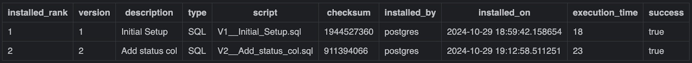
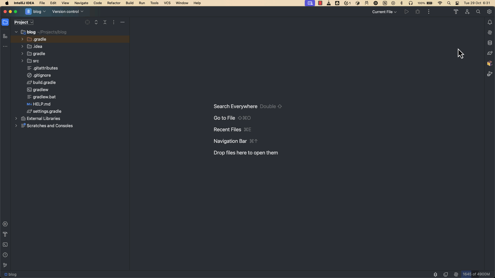
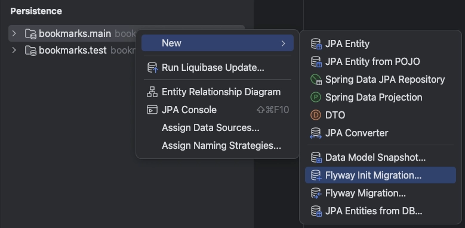
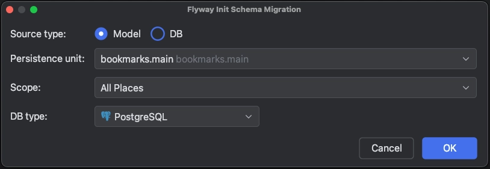
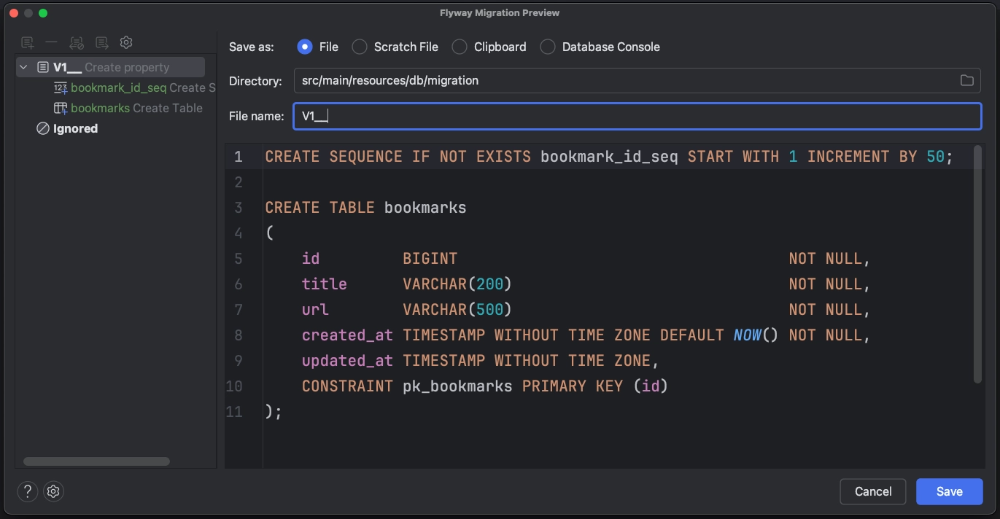
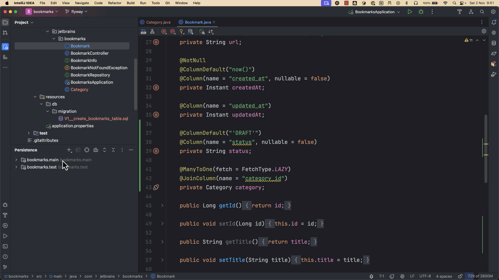
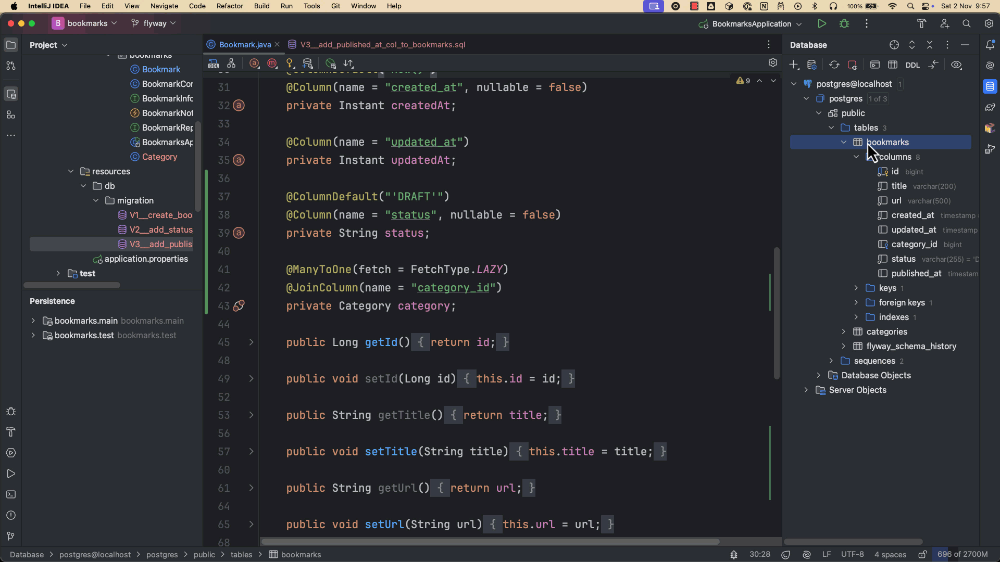

# Cómo utilizar Flyway para las migraciones de bases de datos en aplicaciones Spring Boot

Adaptación para MySQL local en Windows del artículo de JetBrains.

Siva Katamreddy · 12 de noviembre de 2024 · [The JetBrains Blog](https://blog.jetbrains.com/idea/2024/11/how-to-use-flyway-for-database-migrations-in-spring-boot-applications/)

La mayoría de las aplicaciones de software utilizan bases de datos SQL por su fiabilidad, coherencia y madurez a la hora de gestionar datos estructurados. El esquema de la base de datos evoluciona con el tiempo a medida que cambian los requisitos del negocio, ya sea para añadir nuevas funcionalidades o actualizar las existentes.

Los frameworks de mapeo objeto-relacional (ORM), como [JPA](https://jakarta.ee/specifications/persistence/)/[Hibernate](https://hibernate.org/), ofrecen una forma sencilla de generar el esquema de una base de datos a partir de entidades JPA, lo que puede resultar cómodo durante el desarrollo. Por ejemplo, cuando utilizas Spring Data JPA, puedes configurar la propiedad `spring.jpa.hibernate.ddl-auto=update` para crear o actualizar automáticamente las tablas a partir de las entidades JPA.

Sin embargo, actualizar automáticamente el esquema de la base de datos a partir de cambios en las entidades JPA es arriesgado y propenso a errores, especialmente en entornos de producción. Por ello, se recomienda utilizar una herramienta de migración de bases de datos como [Flyway](https://flywaydb.org/).

En este artículo aprenderás lo siguiente:

- Por qué es buena idea utilizar una herramienta de migración de bases de datos como Flyway.
- Cómo funciona Flyway.
- Cómo integrar Flyway en tu aplicación Spring Boot.
- Cómo IntelliJ IDEA te ayuda a generar fácilmente scripts de migración de Flyway.

## Requisitos previos

Para seguir este tutorial, instala el siguiente software:

- Java 17 o posterior.
- MySQL Server 8.0 u 8.4 instalado y en ejecución en Windows, y MySQL Workbench para conectarte a él.
- [IntelliJ IDEA](https://www.jetbrains.com/idea/).

## 1. ¿Por qué utilizar una herramienta de migración de bases de datos?

Aunque los frameworks ORM permiten generar y actualizar el esquema de una base de datos a partir de los modelos de entidades JPA, actualizarlo automáticamente basándose únicamente en los cambios de esas entidades es arriesgado y propenso a errores, especialmente en entornos de producción.

Estos son algunos de los problemas asociados al uso de `spring.jpa.hibernate.ddl-auto=update` para aplicar cambios en la base de datos a partir de cambios en las entidades:

- Aunque los frameworks ORM intentan asignar las propiedades de los objetos a los tipos de columna adecuados, no siempre las asignan a los tipos de datos esperados.
- Las actualizaciones de las entidades JPA pueden no producir los cambios DDL esperados. Por ejemplo, si cambias el nombre de una propiedad de una entidad, en lugar de renombrar la columna, JPA/Hibernate crea una columna nueva y deja la antigua sin cambios.
- El mecanismo de actualización del esquema de JPA/Hibernate no tiene en cuenta las optimizaciones específicas de cada proveedor, como tipos de columna personalizados, particiones de tablas o tipos de índice. Esto puede limitar el ajuste del rendimiento o dar lugar a un rendimiento de la base de datos inferior al óptimo.

Por estas razones, se recomienda utilizar una herramienta de migración de bases de datos como [Flyway](https://www.red-gate.com/products/flyway/).

En este artículo veremos cómo utilizar las migraciones de bases de datos de Flyway en una aplicación Spring Boot.

## 2. Introducción a Flyway

[Flyway](https://www.red-gate.com/products/flyway/) es una herramienta de migración de bases de datos de código abierto que simplifica la gestión y el versionado de los cambios en el esquema de una base de datos.

Con Flyway, los scripts de migración se almacenan junto al código de la aplicación, siguiendo un enfoque coherente y versionado que permite a los equipos gestionar los cambios de la base de datos como parte de su flujo de desarrollo habitual. Flyway admite una amplia variedad de bases de datos, entre ellas MySQL, PostgreSQL, Oracle y SQL Server, además de muchas otras.

Flyway utiliza un sistema de versionado sencillo para gestionar los scripts de migración. A cada script se le asigna un número de versión único —por ejemplo, `V1__init.sql` o `V2__create_articles_table.sql`— que Flyway utiliza para identificar los scripts que ya se han aplicado y los que están pendientes.

La convención de nombres de las migraciones versionadas es:

`{Prefix}{Version}{Separator}{Description}{Suffix}`

De forma predeterminada, en las migraciones versionadas, `{Prefix}` es `V`, `{Separator}` es `__` y `{Suffix}` es `.sql`.

Estos son algunos ejemplos de nombres de migraciones de bases de datos de Flyway:

- `V1__Init_Setup.sql`
- `V2__Add_status_col.sql`
- `V3.1__create_url_index.sql`
- `V3.2__add_updated_by_column_to_bookmarks_table.sql`
- `V4__Add_tags_table.sql`

Una vez creados los scripts de migración, puedes aplicarlos a una base de datos mediante la API Java de Flyway o utilizando su plugin para [Maven](https://documentation.red-gate.com/fd/maven-goal-184127408.html) o [Gradle](https://documentation.red-gate.com/fd/gradle-task-184127407.html).

Flyway registra las migraciones aplicadas en una tabla llamada `flyway_schema_history`, como se muestra a continuación:



*Captura original del historial de Flyway; esta tabla también se utiliza con MySQL.*

**IMPORTANTE:** Una de las principales ventajas de utilizar migraciones de bases de datos versionadas es poder reproducir el proceso de creación de la base de datos y saber cuándo se introdujo un cambio concreto. Por este motivo, una vez aplicada una migración a la base de datos, no debes modificar el contenido de su archivo. Para realizar cualquier cambio en el esquema de la base de datos, debes crear siempre un nuevo script de migración.

## 3. Preparar una base MySQL local en Windows

Utilizaremos el servidor MySQL que ya tienes instalado en Windows. Abre MySQL Workbench y conéctate a tu servidor local con tu usuario y contraseña habituales. Si el servidor está detenido, abre **Servicios** desde el menú Inicio y arranca el servicio correspondiente a MySQL; su nombre depende de la instalación. Una vez conectado, abre una pestaña SQL y crea la base de datos del ejemplo:

```sql
CREATE DATABASE bookmarks CHARACTER SET utf8mb4;
```

Este comando crea la base de datos `bookmarks`, donde Flyway creará las tablas y guardará el historial de migraciones. Para empezar, utiliza una base vacía; si ya tienes una base llamada `bookmarks` con otras tablas, elige otro nombre y úsalo también en la conexión. El servidor seguirá siendo el MySQL instalado en tu equipo. En los siguientes pasos utilizaremos `localhost` y el puerto habitual `3306`; si tu instalación utiliza otro puerto, sustitúyelo en la configuración.

## 4. Crear un proyecto Spring Boot

Empecemos creando un nuevo proyecto Spring Boot y añadiendo las siguientes dependencias:

- Spring Web
- Validation
- Spring Data JPA
- MySQL Driver
- Flyway Migration

> **NOTA:** Si estás empezando con Spring Boot, consulta el artículo [Cómo crear una API REST CRUD con Spring Boot](https://blog.jetbrains.com/idea/2024/10/how-to-build-a-crud-rest-api-using-spring-boot/) para dar tus primeros pasos.

Una vez creado el proyecto y abierto en el IDE, deberías ver las siguientes dependencias de Flyway en el archivo `build.gradle`:

```groovy
implementation 'org.flywaydb:flyway-core'
implementation 'org.flywaydb:flyway-mysql'
runtimeOnly 'com.mysql:mysql-connector-j'
```

Comprueba que el proyecto incluye tanto el controlador `com.mysql:mysql-connector-j` como el módulo `org.flywaydb:flyway-mysql`. El primero permite conectar con MySQL mediante JDBC; el segundo aporta a Flyway el [soporte para este motor](https://documentation.red-gate.com/flyway/reference/database-driver-reference/mysql). Si se ha generado una dependencia específica de PostgreSQL, sustitúyela por las de MySQL. Estas dependencias usan las versiones gestionadas por el proyecto Spring Boot.

Spring Boot ofrece compatibilidad integrada con las [migraciones de bases de datos de Flyway](https://docs.spring.io/spring-boot/how-to/data-initialization.html#howto.data-initialization.migration-tool). Una vez añadida la dependencia, coloca los scripts de migración en `src/main/resources/db/migration`. Al iniciar la aplicación, Spring Boot aplicará automáticamente las migraciones pendientes.


Configura la conexión en `src/main/resources/application.properties`. Sustituye `TU_CONTRASEÑA_MYSQL` por tu contraseña local y, si tu usuario no es `root`, cambia también el nombre de usuario:

```properties
spring.datasource.url=jdbc:mysql://localhost:3306/bookmarks
spring.datasource.username=root
spring.datasource.password=TU_CONTRASEÑA_MYSQL

spring.jpa.hibernate.ddl-auto=validate
```

## 5. Empezar con un enfoque centrado en JPA

Al desarrollar una aplicación Java con JPA, podemos adoptar un enfoque centrado en JPA (*JPA-first*) o en la base de datos (*Database-first*). Supongamos que elegimos el primero: crear las entidades JPA antes de crear el esquema de la base de datos.

Primero, crearemos una entidad JPA llamada `Bookmark` con las propiedades `id`, `title`, `url`, `createdAt` y `updatedAt`, de la siguiente manera:

```java
package com.jetbrains.bookmarks;

import jakarta.persistence.*;
import jakarta.validation.constraints.NotNull;
import jakarta.validation.constraints.Size;
import org.hibernate.annotations.ColumnDefault;
import java.time.Instant;

@Entity
@Table(name = "bookmarks")
public class Bookmark {
    @Id
    @GeneratedValue(strategy = GenerationType.IDENTITY)
    @Column(name = "id", nullable = false)
    private Long id;

    @Size(max = 200)
    @NotNull
    @Column(name = "title", nullable = false, length = 200)
    private String title;

    @Size(max = 500)
    @NotNull
    @Column(name = "url", nullable = false, length = 500)
    private String url;

    @NotNull
    @ColumnDefault("CURRENT_TIMESTAMP(6)")
    @Column(name = "created_at", nullable = false)
    private Instant createdAt;

    @Column(name = "updated_at")
    private Instant updatedAt;

    // setters & getters
}
```

Para la entidad `Bookmark` utilizamos `GenerationType.IDENTITY`, que corresponde a una [columna `AUTO_INCREMENT` de MySQL](https://dev.mysql.com/doc/refman/8.4/en/create-table.html): la base de datos genera el identificador al insertar la fila. La anotación `@ColumnDefault` describe el [valor predeterminado de la columna](https://dev.mysql.com/doc/refman/8.4/en/timestamp-initialization.html) para la generación del DDL; no asigna por sí sola un valor al atributo del objeto Java.

Ahora queremos crear nuestra primera migración de Flyway para crear la tabla `bookmarks`. Podemos escribir los scripts de migración manualmente o utilizar las funciones de IntelliJ IDEA para generarlos a partir de las entidades JPA.

**NOTA:** IntelliJ IDEA ofrece herramientas para trabajar con Flyway que facilitan la creación de migraciones.

## 6. Crear migraciones de Flyway manualmente

Podemos crear manualmente un archivo llamado `V1__create_bookmarks_table.sql` dentro del directorio `src/main/resources/db/migration` con el siguiente contenido:

```sql
CREATE TABLE bookmarks
(
   id         BIGINT NOT NULL AUTO_INCREMENT,
   title      VARCHAR(200) NOT NULL,
   url        VARCHAR(500) NOT NULL,
   created_at DATETIME(6) NOT NULL DEFAULT CURRENT_TIMESTAMP(6),
   updated_at DATETIME(6) NULL,
   CONSTRAINT pk_bookmarks PRIMARY KEY (id)
);
```

¿Y si no sabes con seguridad cómo escribir las sentencias DDL o no conoces la sintaxis y los tipos de datos de las columnas de tu base de datos? Imagina cuánto más fácil sería si el IDE pudiera generar esas sentencias por ti, adaptadas a la base de datos concreta que utilizas. ¡IntelliJ IDEA puede hacer precisamente eso!

## 7. Generar migraciones de Flyway con IntelliJ IDEA

En lugar de crear manualmente el script de migración, podemos utilizar las funciones de IntelliJ IDEA para generar la migración inicial de Flyway a partir de las entidades JPA existentes.

Primero, conectémonos a la base MySQL local utilizando las herramientas de bases de datos de IntelliJ IDEA y los siguientes parámetros. Introduce tu contraseña real en el campo correspondiente; el texto en mayúsculas es solo un marcador:

```text
Host: localhost
Port: 3306
Username: root
Password: TU_CONTRASEÑA_MYSQL
Database: bookmarks
```

Puedes abrir la ventana de herramientas **Database** haciendo clic en el icono de base de datos de la barra de herramientas de la derecha, o desde **View | Tool Windows | Database**. Crea una fuente de datos de tipo **MySQL**, introduce los valores anteriores y haz clic en **Test Connection** para comprobar la conexión. Si el IDE solicita descargar el controlador de MySQL, acepta la descarga.


*Las imágenes y los GIF conservados del artículo original muestran PostgreSQL. Sirven para localizar las opciones del IDE; en tu configuración selecciona MySQL y utiliza los datos de conexión de este texto.*



*GIF original: muestra PostgreSQL. En este ejercicio crea una conexión MySQL con puerto 3306.*

Ahora abre la ventana de herramientas **Persistence** desde **View | Tool Windows | Persistence**. A continuación, haz clic con el botón derecho en la unidad de persistencia principal y selecciona **New | Flyway Init Migration**.



*Captura original: la opción para generar la migración se encuentra en Persistence.*

En el cuadro de diálogo **Flyway Init Schema Migration**, selecciona **Model** como tipo de origen (**Source**), **MySQL** como tipo de base de datos (**DB type**) y haz clic en **OK**.



*Captura original: selecciona MySQL en DB type, en lugar de PostgreSQL.*

IntelliJ IDEA analizará los modelos JPA existentes y mostrará una vista previa del script de migración de Flyway que se va a generar. Comprueba que el SQL es de MySQL: las claves generadas deben usar `AUTO_INCREMENT`, y las fechas, los tipos y la sintaxis deben corresponder a este motor.



*Captura original con SQL de PostgreSQL. Para MySQL utiliza el script de este artículo con AUTO_INCREMENT.*

Introduce un nombre de archivo (**File name**) que siga la convención de Flyway: `V1__create_bookmarks_table.sql`, y haz clic en **Save**. El archivo se creará en el directorio `src/main/resources/db/migration`.

Si ejecutas ahora la aplicación Spring Boot, se aplicará la primera migración de Flyway, `V1__create_bookmarks_table.sql`, y se creará la tabla `bookmarks`.

## 8. Modificar las entidades JPA y generar nuevas migraciones

Una vez aplicadas las migraciones de la base de datos, la entidad JPA y el esquema de la base de datos están sincronizados. Sin embargo, a medida que evoluciona la aplicación, puede que necesitemos crear entidades nuevas o modificar las existentes según nuestros requisitos. En ese caso, debemos llevar un registro de los cambios concretos que hacemos en las entidades existentes para crear el script de migración correspondiente.

Supongamos que queremos clasificar los marcadores por categorías y añadir una columna llamada `status` para indicar si un marcador está en estado `DRAFT` o `PUBLISHED`.


Crea una nueva entidad JPA llamada `Category` de la siguiente manera:

```java
package com.jetbrains.bookmarks;

import jakarta.persistence.Entity;
import jakarta.persistence.GeneratedValue;
import jakarta.persistence.GenerationType;
import jakarta.persistence.Id;
import jakarta.persistence.Table;

@Entity
@Table(name = "categories")
public class Category {
   @Id
   @GeneratedValue(strategy = GenerationType.IDENTITY)
   private Long id;

   private String name;

   // setters and getters
}
```

Actualiza la entidad `Bookmark` para añadir una propiedad de tipo `String` llamada `status`, con el valor predeterminado `DRAFT`, y una relación `ManyToOne` con `Category`, de la siguiente manera:

```java
package com.jetbrains.bookmarks;

import jakarta.persistence.Column;
import jakarta.persistence.Entity;
import jakarta.persistence.FetchType;
import jakarta.persistence.GeneratedValue;
import jakarta.persistence.GenerationType;
import jakarta.persistence.Id;
import jakarta.persistence.JoinColumn;
import jakarta.persistence.ManyToOne;
import jakarta.persistence.Table;
import org.hibernate.annotations.ColumnDefault;

import java.time.Instant;

@Entity
@Table(name = "bookmarks")
public class Bookmark {
   //...
   @ColumnDefault("'DRAFT'")
   @Column(name = "status", nullable = false)
   private String status;
  
   @ManyToOne(fetch = FetchType.LAZY)
   @JoinColumn(name = "category_id")
   private Category category;

   // setters and getters
}
```

Para realizar los cambios correspondientes en el esquema de la base de datos, debemos crear el segundo script de migración de Flyway.

Sin embargo, llevar manualmente un registro de los cambios realizados en las entidades JPA y crear las migraciones es una tarea tediosa y propensa a errores.

Por ello, en lugar de escribir el script manualmente, podemos utilizar IntelliJ IDEA para generar la migración de Flyway a partir de las diferencias entre las entidades JPA y el esquema existente de la base de datos.

En la ventana de herramientas **Persistence**, haz clic con el botón derecho en la unidad de persistencia principal y selecciona **New | Flyway Migration**. En el cuadro de diálogo **Flyway Diff Migration**, selecciona **Model** como origen (**Source**) y tu conexión a la base `bookmarks` de **MySQL** como destino de base de datos (**DB / Target**). Haz clic en **OK**.

IntelliJ IDEA analizará los modelos JPA y el esquema existente de la base de datos, y mostrará una vista previa del script de migración de Flyway que se va a generar.

En **File name**, introduce `V2__add_status_category_to_bookmarks.sql` y haz clic en **Save**.



*GIF original de la generación de diferencias. En tu proyecto selecciona la conexión MySQL.*

El archivo `V2__add_status_category_to_bookmarks.sql` se creará en `src/main/resources/db/migration`. Para MySQL, el contenido equivalente es el siguiente:

```sql
CREATE TABLE categories
(
   id   BIGINT NOT NULL AUTO_INCREMENT,
   name VARCHAR(255),
   CONSTRAINT pk_categories PRIMARY KEY (id)
);

ALTER TABLE bookmarks
   ADD COLUMN category_id BIGINT;

ALTER TABLE bookmarks
   ADD COLUMN status VARCHAR(255) NOT NULL DEFAULT 'DRAFT';

ALTER TABLE bookmarks
   ADD CONSTRAINT fk_bookmarks_category
   FOREIGN KEY (category_id) REFERENCES categories (id);
```

El segundo script crea la tabla `categories` con una clave `AUTO_INCREMENT` y añade a `bookmarks` la clave foránea `category_id` y una columna `status`, obligatoria y con valor predeterminado `DRAFT`. En MySQL, al añadir esta columna, las filas que ya existían reciben ese valor predeterminado.

Si reinicias la aplicación Spring Boot y compruebas la base de datos, debería haberse creado la tabla `categories` y deberían haberse añadido las columnas `category_id` y `status` a la tabla `bookmarks`.

## 9. Actualizar las entidades JPA existentes a partir de cambios en el esquema

Hasta ahora hemos visto cómo generar migraciones de Flyway a partir de las entidades JPA. ¿Y si queremos escribir manualmente un script de migración de Flyway, aplicarlo a la base de datos y actualizar después las entidades JPA de acuerdo con esos cambios en el esquema?

Para ello, crea un tercer script de migración de Flyway llamado `V3__add_published_at_col_to_bookmarks.sql` con el siguiente SQL para MySQL:

```sql
ALTER TABLE bookmarks ADD COLUMN published_at DATETIME(6) NULL;
```

Estamos añadiendo una nueva columna llamada `published_at` a la tabla `bookmarks`.

Reinicia la aplicación Spring Boot y comprueba que la columna `published_at` se haya añadido a la tabla `bookmarks`.

Para mantener sincronizados el esquema de la base de datos y las entidades JPA, debemos añadir una propiedad `publishedAt` a la entidad `Bookmark`. En lugar de hacer esos cambios manualmente, podemos utilizar la función de IntelliJ IDEA que permite añadir o actualizar atributos de entidades a partir de la base de datos.


En la ventana de herramientas **Database**, haz clic con el botón derecho en la tabla `bookmarks` y selecciona **Create Entity Attributes from DB**. El cuadro de diálogo **Entity Attributes from DB** mostrará las columnas que aún no se han añadido a la entidad `Bookmark`. Selecciona las columnas correspondientes y haz clic en **OK**.



*GIF original: el mismo procedimiento permite actualizar la entidad desde tu tabla MySQL.*

La entidad `Bookmark` se actualizará para incorporar la propiedad `publishedAt` de la siguiente manera:

```java
package com.jetbrains.bookmarks;

import jakarta.persistence.Column;
import jakarta.persistence.Entity;
import jakarta.persistence.FetchType;
import jakarta.persistence.GeneratedValue;
import jakarta.persistence.GenerationType;
import jakarta.persistence.Id;
import jakarta.persistence.JoinColumn;
import jakarta.persistence.ManyToOne;
import jakarta.persistence.Table;
import org.hibernate.annotations.ColumnDefault;

import java.time.Instant;


@Entity
@Table(name = "bookmarks")
public class Bookmark {
   //...
  
   @Column(name = "published_at")
   private Instant publishedAt;

   // setters and getters
}
```

Aunque puedes escribir las migraciones de Flyway manualmente, IntelliJ IDEA te ayuda a crearlas automáticamente a partir de los cambios en las entidades JPA. Además, permite actualizar con mayor facilidad las entidades JPA a partir de los cambios en la base de datos. Esto reduce considerablemente la cantidad de código que hay que escribir a mano, evita posibles errores y mejora la productividad del desarrollo.

## Resumen

En este artículo hemos aprendido a utilizar Flyway para gestionar las migraciones de bases de datos en una aplicación Spring Boot. Si desarrollamos una aplicación basada en JPA con un enfoque centrado en las entidades, IntelliJ IDEA nos ayuda a crear las migraciones de Flyway a partir de ellas. A medida que la aplicación evoluciona, podemos actualizar las entidades JPA y generar nuevas migraciones basadas en las diferencias entre esas entidades y el esquema actual de la base de datos. Por último, hemos visto cómo actualizar las entidades JPA directamente a partir de los cambios en la base de datos.


Para saber más sobre Flyway, consulta la [documentación oficial](https://documentation.red-gate.com/fd/flyway-documentation-138346877.html).
