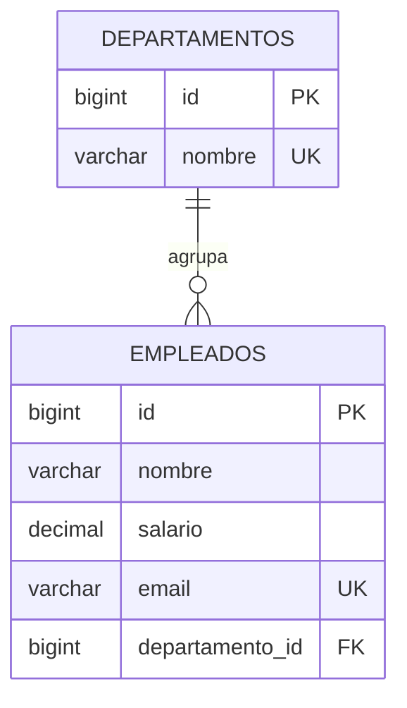
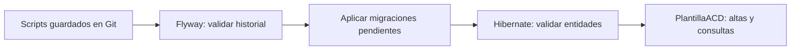

# Flyway: evolución de bases de datos con Java, JPA y MySQL

**Asignatura:** Acceso a Datos · **Tema 3:** JPA  
**Caso conductor:** PlantillaACD, gestión de empleados de un centro de formación.  
**Nivel:** se presupone Java básico, SQL, Maven y una primera aproximación a JPA.  
**Dedicación orientativa:** dos o tres sesiones de clase, más las actividades.

## Introducción: por qué necesitamos controlar los cambios de la base de datos

Imagina que trabajamos para un centro de formación. La primera versión de su aplicación guarda nombres y salarios de sus empleados. Semanas después, el centro pide un correo corporativo por empleado y un informe de costes por departamento.

Cambiar las clases Java parece sencillo: añadimos `email` y una relación con `Departamento`. Sin embargo, la base de datos que ya contiene la plantilla sigue teniendo la estructura anterior. En el ordenador de un compañero quizá ya existe la columna; en el aula, todavía no; en producción, hay cientos de filas que no podemos borrar. Copiar un `ALTER TABLE` por un chat tampoco garantiza que todos lo ejecuten, que lo hagan en el mismo orden o que sepan qué versión tienen.

Los problemas que queremos evitar son concretos:

- Que el programa funcione en un equipo y falle en otro por diferencias en el esquema.
- Que una nueva columna obligatoria haga imposible actualizar datos antiguos.
- Que un script se ejecute dos veces y duplique datos o provoque errores.
- Que desaparezca el conocimiento de qué cambió, cuándo y por qué.
- Que una actualización automática del ORM transforme tablas sin un plan explícito para sus datos.

**La propuesta central de Flyway es expresar la evolución de la base de datos como una secuencia de migraciones guardadas junto al código.** Cada base registra cuáles ha aplicado. Al actualizarla, Flyway comprueba el historial y ejecuta las pendientes en orden. Esto aporta repetibilidad, trazabilidad y una forma compartida de desplegar cambios.

Flyway no conoce las reglas de nuestro centro ni decide qué hacer con sus datos: nosotros escribimos y revisamos el SQL. Su valor es organizar y verificar la aplicación de ese SQL. A lo largo del tutorial construiremos una aplicación pequeña pero funcional y veremos cómo evoluciona sin perder la plantilla existente.

El material enlaza con [los apuntes de JPA del tema](Java%20Persistance%20API.md): usaremos `Empleado`, `Departamento`, `EntityManager`, relaciones y transacciones. Aquí fijamos una combinación coherente con `jakarta.persistence`; no hay que combinarla con dependencias de Hibernate 5 o imports `javax.persistence` de ejemplos antiguos.

## Índice

1. [El caso de negocio y sus versiones](#1-el-caso-de-negocio-y-sus-versiones)
2. [Qué hace cada pieza: SQL, JPA, Hibernate y Flyway](#2-qué-hace-cada-pieza-sql-jpa-hibernate-y-flyway)
3. [Cómo funciona Flyway](#3-cómo-funciona-flyway)
4. [Preparar el entorno y ejecutar el proyecto](#4-preparar-el-entorno-y-ejecutar-el-proyecto)
5. [Proyecto Maven y dependencias](#5-proyecto-maven-y-dependencias)
6. [Primera entrega: tablas y plantilla inicial](#6-primera-entrega-tablas-y-plantilla-inicial)
7. [Segunda entrega: correo corporativo sin perder datos](#7-segunda-entrega-correo-corporativo-sin-perder-datos)
8. [Tercera entrega: departamentos e informe de costes](#8-tercera-entrega-departamentos-e-informe-de-costes)
9. [Integración con JPA e implementación del programa](#9-integración-con-jpa-e-implementación-del-programa)
10. [Práctica guiada: actualizar una instalación antigua](#10-práctica-guiada-actualizar-una-instalación-antigua)
11. [Inspección, validación y diagnóstico](#11-inspección-validación-y-diagnóstico)
12. [Fallos, reparación y recuperación](#12-fallos-reparación-y-recuperación)
13. [Adoptar Flyway en una base que ya existe](#13-adoptar-flyway-en-una-base-que-ya-existe)
14. [La misma aplicación con Spring Boot](#14-la-misma-aplicación-con-spring-boot)
15. [Pruebas automáticas](#15-pruebas-automáticas)
16. [Trabajo en equipo y despliegue](#16-trabajo-en-equipo-y-despliegue)
17. [Actividades y criterios de evaluación](#17-actividades-y-criterios-de-evaluación)
18. [Autoevaluación con respuestas](#18-autoevaluación-con-respuestas)
19. [Referencias oficiales](#19-referencias-oficiales)

## 1. El caso de negocio y sus versiones

### El problema que resuelve PlantillaACD

La administración del centro necesita saber quién trabaja en él y cuánto representa su salario bruto anual. Al crecer el centro, también necesita contactar con cada empleado y separar los costes de Docencia y Administración. Centralizar esos datos evita hojas de cálculo divergentes y permite obtener un informe consistente.

La aplicación de consola tendrá tres operaciones de negocio:

| Operación | Necesidad del centro | Ejemplo |
|---|---|---|
| `listar` | Consultar empleados, correo, departamento y salario | Revisar la plantilla actual |
| `alta` | Registrar una incorporación | Contratar a Marta en Administración |
| `informe` | Consultar efectivos y suma de salarios por departamento | Preparar el presupuesto anual |

El informe suma **salarios brutos anuales**, no calcula nóminas, cotizaciones ni coste empresarial completo. Todos los nombres y correos del ejemplo son ficticios.

### Hoja de ruta de la base de datos

| Entrega de negocio | Migración | Cambio y motivo |
|---|---|---|
| Registro inicial | `V1` | Crear empleados y catálogo de departamentos |
| Demostración inicial | `V2` | Incorporar dos empleados y dos departamentos ficticios |
| Comunicación corporativa | `V3` | Añadir un correo obligatorio y único, rellenando los existentes |
| Control de costes | `V4` | Asignar un departamento obligatorio a cada empleado |
| Informe de dirección | `R__...` | Definir una vista SQL que agrega salarios y empleados |

La aplicación incluida representa **el estado final**, después de V4. Las entregas anteriores se estudian mediante los scripts y una práctica que detiene la base en V2. No ejecutaremos el modelo Java final contra una base antigua sin migrar: precisamente queremos evitar esa incompatibilidad.



Cada empleado pertenece a un departamento; un departamento puede estar vacío. Esa última regla será importante para que Administración aparezca inicialmente con cero empleados en el informe.

## 2. Qué hace cada pieza: SQL, JPA, Hibernate y Flyway

### Por qué separar las responsabilidades

Guardar una nueva contratación y añadir una columna son operaciones distintas. Si dejamos que varias herramientas creen y modifiquen el esquema a la vez, resulta difícil explicar de dónde salió una tabla o por qué dos instalaciones son diferentes. Separar responsabilidades permite revisar cada cambio y detectar incompatibilidades antes de usar la aplicación.

| Pieza | Responsabilidad en PlantillaACD |
|---|---|
| MySQL | Almacenar datos y hacer cumplir claves, tipos y restricciones |
| SQL de migración | Describir cómo transformar el esquema y los datos existentes |
| Flyway | Ordenar, registrar y validar esas migraciones |
| JPA | Definir cómo trabajar con entidades desde Java |
| Hibernate | Implementar JPA y validar que el esquema permite usar esas entidades |
| `EntityManager` | Consultar y persistir empleados en las operaciones del programa |
| Git | Versionar y compartir código y scripts |

En los apuntes aparecen configuraciones con `hibernate.hbm2ddl.auto=update`. Son útiles para experimentar con un modelo, pero no expresan una política de migración de datos: Hibernate no puede deducir, por ejemplo, qué correo corresponde a un empleado antiguo o si un cambio de nombre de atributo significa renombrar una columna.

En este proyecto la decisión es explícita:

```properties
hibernate.hbm2ddl.auto=validate
```

En Spring Boot, su equivalente es:

```properties
spring.jpa.hibernate.ddl-auto=validate
```

Flyway modifica el esquema; Hibernate comprueba el mapeo al arrancar. No activaremos simultáneamente `update`, `create` o `create-drop`, ni usaremos otro inicializador para las mismas tablas. Este reparto también coincide con la recomendación de usar un mecanismo único de inicialización del esquema en [la documentación de Spring Boot](https://docs.spring.io/spring-boot/3.4/how-to/data-initialization.html).

**Límite importante:** `validate` de Hibernate no constituye una auditoría completa de todas las claves, índices, restricciones o reglas de negocio. Por eso también inspeccionaremos SQL y escribiremos pruebas.

## 3. Cómo funciona Flyway

### Por qué necesita un historial

El mismo programa puede conectarse a una base vacía, a otra que terminó en V2 o a otra que ya está actualizada. Para decidir qué hacer sin adivinar, Flyway mantiene una tabla llamada `flyway_schema_history` en cada base gestionada.

El flujo normal de `migrate` es:

1. Encontrar los scripts de las ubicaciones configuradas.
2. Consultar o crear su historial en la base destino.
3. Validar las migraciones aplicadas frente a los archivos disponibles.
4. Ejecutar las migraciones versionadas pendientes por orden de versión.
5. Ejecutar las repetibles nuevas o cuyo contenido haya cambiado.
6. Registrar el resultado y detenerse si una migración falla.



### Migraciones versionadas

Se nombran así:

```text
V<version>__<descripcion>.sql

V1__crear_tablas_iniciales.sql
V2__cargar_datos_de_ejemplo.sql
V3__incorporar_correo_corporativo.sql
V4__asignar_empleados_a_departamentos.sql
```

Hay **dos guiones bajos** entre versión y descripción. Usaremos `V` mayúscula, extensión `.sql`, descripciones sin espacios ni tildes y una versión única por migración. Flyway ordena las versiones numéricamente: V2 va antes de V10. Se admiten versiones compuestas, pero aquí bastan enteros.

Una migración versionada aplicada correctamente no vuelve a ejecutarse en esa base durante el flujo normal. Su contenido queda asociado a un **checksum**, una huella utilizada para detectar cambios posteriores. Si ya se ha compartido o aplicado en una instalación persistente, la evolución se expresa mediante una versión nueva. Véase [migraciones versionadas](https://documentation.red-gate.com/flyway/flyway-concepts/migrations/versioned-migrations).

### Migraciones repetibles

Una vista tiene una definición vigente que puede sustituirse sin acumular todos sus cambios en un mismo fichero versionado. Para eso existe:

```text
R__resumen_costes_por_departamento.sql
```

No lleva número de versión. Se aplica cuando es nueva y se vuelve a aplicar cuando cambia su checksum, **después de las versionadas pendientes**. Si hay varias repetibles, se ordenan por descripción. El SQL debe poder ejecutarse varias veces; usaremos `CREATE OR REPLACE VIEW`.

Una repetible **no se ejecuta en todos los arranques** si no ha cambiado. Tampoco sirve para insertar contrataciones: un `INSERT` repetido podría duplicarlas. El comportamiento está explicado en [migraciones repetibles](https://documentation.red-gate.com/flyway/flyway-concepts/migrations/repeatable-migrations).

### Historial y datos de negocio no son lo mismo

El historial registra, entre otros campos, versión, script, descripción, checksum, fecha y éxito. No contiene una copia de la plantilla ni de sus salarios; no es un respaldo. Además, una persona podría ejecutar un `ALTER TABLE` manual sin modificar los archivos: validar los checksums no detecta por sí solo todas las diferencias reales del esquema.

## 4. Preparar el entorno y ejecutar el proyecto

### Por qué ofrecer un entorno reproducible

Usar la misma versión del servidor y las mismas dependencias reduce diferencias de sintaxis y facilita comparar resultados en clase. El proyecto permite dos recorridos: ejecutar directamente el programa completo o estudiar, sección por sección, cómo se ha construido.

### Requisitos

- JDK 17 o 21, con `JAVA_HOME` apuntando al JDK correcto.
- Maven 3.9.x. Comprueba el Java efectivo con `mvn -version`.
- Docker Desktop con Docker Compose, o una instalación de MySQL 8.4.
- Git y un editor como IntelliJ IDEA, Eclipse o Visual Studio Code.
- Internet para la primera descarga de dependencias e imagen de MySQL.

Comprobaciones:

```text
java -version
mvn -version
docker version
docker compose version
```

Las versiones fijadas para este ejercicio son Flyway **11.8.2**, Hibernate **6.6.36.Final**, MySQL Server **8.4.4**, Connector/J **9.2.0** y Jakarta Persistence 3.1 proporcionada por Hibernate. Son una combinación de referencia del ejemplo, **no una afirmación de que sean las últimas versiones disponibles**. Para actualizar una biblioteca, se revisan compatibilidad y pruebas; no basta con cambiar el número.

### Descargar y entrar en la carpeta correcta

```text
git clone https://github.com/javierfausgmail/ACD.git
cd "ACD/Tema 3 - JPA/ejemplo-flyway"
```

Si ya tienes el repositorio, actualiza tu copia mediante tu flujo habitual y entra en `Tema 3 - JPA/ejemplo-flyway`. Todos los comandos siguientes, salvo indicación contraria, se ejecutan desde esa carpeta, donde está `pom.xml`.

### MySQL mediante Docker Compose

Archivo `compose.yaml` completo:

```yaml
services:
  mysql:
    image: mysql:8.4.4
    environment:
      MYSQL_ROOT_PASSWORD: ${MYSQL_ROOT_PASSWORD:?Define MYSQL_ROOT_PASSWORD en tu terminal}
      MYSQL_DATABASE: acd_flyway
      MYSQL_USER: acd
      MYSQL_PASSWORD: ${DB_PASSWORD:?Define DB_PASSWORD en tu terminal}
    ports:
      - "127.0.0.1:13307:3306"
    volumes:
      - mysql-data:/var/lib/mysql
    healthcheck:
      test: ["CMD-SHELL", "MYSQL_PWD=$$MYSQL_PASSWORD mysql --protocol=TCP -h 127.0.0.1 -u$$MYSQL_USER -D $$MYSQL_DATABASE -e 'SELECT 1' >/dev/null 2>&1"]
      interval: 5s
      timeout: 5s
      retries: 30
      start_period: 30s
volumes:
  mysql-data:
```

Antes de arrancar el servicio, define las variables del siguiente apartado de conexión. Compose exige que existan `DB_PASSWORD` y `MYSQL_ROOT_PASSWORD`: cada alumno elige sus valores localmente, sin guardarlos en este repositorio.

Desde Java se usa `localhost:13307`; dentro del contenedor el servidor escucha en 3306. Así reducimos conflictos con un MySQL local. El volumen conserva datos entre reinicios: detener el contenedor no devuelve el esquema a V1.

El laboratorio está enlazado a `127.0.0.1`. En una instalación compartida se separan los permisos de migración de los del usuario de aplicación.

### Alternativa: MySQL instalado

Conéctate como administrador y ejecuta una sola vez sobre un servidor de prácticas:

```sql
CREATE DATABASE acd_flyway CHARACTER SET utf8mb4 COLLATE utf8mb4_0900_ai_ci;
CREATE USER 'acd'@'localhost' IDENTIFIED BY '<tu_contrasena_local>';
GRANT ALL PRIVILEGES ON acd_flyway.* TO 'acd'@'localhost';
```

Sustituye `<tu_contrasena_local>` por una contraseña propia antes de ejecutar el SQL y usa ese mismo valor en `DB_PASSWORD`; el texto entre ángulos es un marcador, no una contraseña proporcionada. Estos permisos amplios están acotados a la base del ejercicio. Flyway necesitará crear tablas, índices y vistas; un usuario limitado a `SELECT` e `INSERT` no podrá migrar. Si el programa está en otra máquina, adapta host y permisos con el administrador.

### Configurar la conexión sin escribir contraseñas en Java

El programa y el plugin Maven leen las mismas tres variables de conexión. Compose necesita además la contraseña de root para inicializar su servidor local. En **PowerShell**, elige las contraseñas cuando se soliciten:

```powershell
$env:DB_URL = 'jdbc:mysql://localhost:13307/acd_flyway?sslMode=DISABLED&allowPublicKeyRetrieval=true&serverTimezone=UTC&characterEncoding=UTF-8'
$env:DB_USER = 'acd'
$env:DB_PASSWORD = [Net.NetworkCredential]::new('', (Read-Host 'Contraseña para el usuario de prácticas' -AsSecureString)).Password
$env:MYSQL_ROOT_PASSWORD = [Net.NetworkCredential]::new('', (Read-Host 'Contraseña para root de este MySQL local' -AsSecureString)).Password
```

En **Bash**:

```bash
export DB_URL='jdbc:mysql://localhost:13307/acd_flyway?sslMode=DISABLED&allowPublicKeyRetrieval=true&serverTimezone=UTC&characterEncoding=UTF-8'
export DB_USER='acd'
read -r -s -p 'Contraseña para el usuario de prácticas: ' DB_PASSWORD
printf '\n'
export DB_PASSWORD
read -r -s -p 'Contraseña para root de este MySQL local: ' MYSQL_ROOT_PASSWORD
printf '\n'
export MYSQL_ROOT_PASSWORD
```

Para un MySQL instalado normalmente cambia 13307 por 3306 y no necesitas `MYSQL_ROOT_PASSWORD` para ejecutar el programa; la cuenta `acd` ya debe existir con la contraseña elegida. Las opciones que desactivan TLS y permiten recuperar la clave pública corresponden a este laboratorio local; la conexión de un servidor real debe configurarse con su política de TLS.

Las variables solo afectan a la terminal actual y a sus procesos hijos. Si ejecutas desde el IDE, defínelas en su configuración de ejecución. Un fichero `.env` no se carga automáticamente en la aplicación Java; no basta con crearlo.

Si utilizas Docker, arráncalo ahora, desde esta misma terminal:

```text
docker compose up -d --wait
docker compose ps
```

El servicio debe quedar saludable. Las variables de contraseña de Compose inicializan las cuentas **solo la primera vez que el volumen está vacío**. Si abres otra terminal o reinicias el equipo, vuelve a configurar las mismas contraseñas: cambiar una variable no cambia automáticamente la contraseña de una cuenta ya creada. Conserva tus valores fuera del repositorio.

### Primera ejecución: resultado de negocio

```text
mvn test
mvn compile exec:java "-Dexec.args=listar"
mvn exec:java "-Dexec.args=informe"
```

En una base nueva, además de los mensajes técnicos, deben aparecer estos datos:

```text
1 | Ana | empleado1@plantilla.example.test | Docencia | 32000.00 EUR/año
2 | Luis | empleado2@plantilla.example.test | Docencia | 28000.00 EUR/año

Docencia | 2 empleados | 60000.00 EUR/año
Administración | 0 empleados | 0.00 EUR/año
```

Da de alta a Marta:

```text
mvn exec:java "-Dexec.args=alta Marta marta@plantilla.example.test 31000.00 2"
mvn exec:java "-Dexec.args=listar"
mvn exec:java "-Dexec.args=informe"
```

Administración pasa a tener una empleada y 31000.00 EUR/año. Su alta se hace con JPA, no escribiendo otra migración. Si repites exactamente el alta, la unicidad del correo debe rechazarla; usa otro correo para otra persona. Los identificadores de altas nuevas pueden tener huecos, incluso tras un fallo: no son un contador de empleados.

`mvn test` no necesita MySQL ni las variables: las pruebas crean bases H2 temporales. El programa de consola sí utiliza la conexión MySQL configurada.

### Detener el laboratorio

```text
docker compose stop
docker compose start --wait
```

`stop` conserva datos. Para reiniciar **desde cero solo este laboratorio**, puedes usar `docker compose down -v` y después `docker compose up -d --wait`. La opción `-v` borra el volumen y todos sus datos; no la uses si quieres conservar las altas ni para recuperar una instalación real.

## 5. Proyecto Maven y dependencias

### Por qué no basta con añadir una biblioteca

Flyway necesita su motor, soporte para el tipo de base y un controlador JDBC. Hibernate también necesita las dependencias compatibles con el API JPA utilizado. Un proyecto completo evita que los alumnos tengan que reconstruir piezas implícitas o mezclar generaciones de bibliotecas.

Estructura del [proyecto acompañante](ejemplo-flyway/):

```text
ejemplo-flyway/
├── pom.xml
├── compose.yaml
├── src/main/java/es/acd/plantilla/
│   ├── App.java
│   ├── Configuracion.java
│   ├── Departamento.java
│   └── Empleado.java
├── src/main/resources/
│   ├── META-INF/persistence.xml
│   └── db/migration/
│       ├── versioned/
│       │   ├── V1__crear_tablas_iniciales.sql
│       │   ├── V2__cargar_datos_de_ejemplo.sql
│       │   ├── V3__incorporar_correo_corporativo.sql
│       │   └── V4__asignar_empleados_a_departamentos.sql
│       └── repeatable/
│           └── R__resumen_costes_por_departamento.sql
└── src/test/java/es/acd/plantilla/MigracionesTest.java
```

Las subcarpetas `versioned` y `repeatable` son organizativas. Flyway explora sus recursos de forma recursiva; no son ubicaciones con reglas especiales. La aplicación carga `classpath:db/migration`. El plugin Maven usa `filesystem:src/main/resources/db/migration` para leer los scripts originales sin depender de una compilación previa.

### `pom.xml` completo

```xml
<?xml version="1.0" encoding="UTF-8"?>
<project xmlns="http://maven.apache.org/POM/4.0.0"
         xmlns:xsi="http://www.w3.org/2001/XMLSchema-instance"
         xsi:schemaLocation="http://maven.apache.org/POM/4.0.0 https://maven.apache.org/xsd/maven-4.0.0.xsd">
    <modelVersion>4.0.0</modelVersion>
    <groupId>es.acd</groupId>
    <artifactId>plantilla-acd</artifactId>
    <version>1.0.0</version>
    <properties>
        <maven.compiler.release>17</maven.compiler.release>
        <project.build.sourceEncoding>UTF-8</project.build.sourceEncoding>
        <flyway.version>11.8.2</flyway.version>
        <hibernate.version>6.6.36.Final</hibernate.version>
        <mysql.version>9.2.0</mysql.version>
    </properties>
    <dependencies>
        <dependency>
            <groupId>org.flywaydb</groupId>
            <artifactId>flyway-core</artifactId>
            <version>${flyway.version}</version>
        </dependency>
        <dependency>
            <groupId>org.flywaydb</groupId>
            <artifactId>flyway-mysql</artifactId>
            <version>${flyway.version}</version>
        </dependency>
        <dependency>
            <groupId>org.hibernate.orm</groupId>
            <artifactId>hibernate-core</artifactId>
            <version>${hibernate.version}</version>
        </dependency>
        <dependency>
            <groupId>com.mysql</groupId>
            <artifactId>mysql-connector-j</artifactId>
            <version>${mysql.version}</version>
            <scope>runtime</scope>
        </dependency>
        <dependency>
            <groupId>com.h2database</groupId>
            <artifactId>h2</artifactId>
            <version>2.3.232</version>
            <scope>test</scope>
        </dependency>
        <dependency>
            <groupId>org.junit.jupiter</groupId>
            <artifactId>junit-jupiter</artifactId>
            <version>5.12.2</version>
            <scope>test</scope>
        </dependency>
    </dependencies>
    <build>
        <plugins>
            <plugin>
                <groupId>org.apache.maven.plugins</groupId>
                <artifactId>maven-compiler-plugin</artifactId>
                <version>3.14.0</version>
            </plugin>
            <plugin>
                <groupId>org.apache.maven.plugins</groupId>
                <artifactId>maven-surefire-plugin</artifactId>
                <version>3.5.3</version>
            </plugin>
            <plugin>
                <groupId>org.codehaus.mojo</groupId>
                <artifactId>exec-maven-plugin</artifactId>
                <version>3.5.0</version>
                <configuration>
                    <mainClass>es.acd.plantilla.App</mainClass>
                    <cleanupDaemonThreads>false</cleanupDaemonThreads>
                </configuration>
            </plugin>
            <plugin>
                <groupId>org.flywaydb</groupId>
                <artifactId>flyway-maven-plugin</artifactId>
                <version>${flyway.version}</version>
                <configuration>
                    <url>${env.DB_URL}</url>
                    <user>${env.DB_USER}</user>
                    <password>${env.DB_PASSWORD}</password>
                    <locations>
                        <location>filesystem:src/main/resources/db/migration</location>
                    </locations>
                    <cleanDisabled>true</cleanDisabled>
                    <baselineOnMigrate>false</baselineOnMigrate>
                    <validateOnMigrate>true</validateOnMigrate>
                    <validateMigrationNaming>true</validateMigrationNaming>
                </configuration>
                <dependencies>
                    <dependency>
                        <groupId>org.flywaydb</groupId>
                        <artifactId>flyway-mysql</artifactId>
                        <version>${flyway.version}</version>
                    </dependency>
                    <dependency>
                        <groupId>com.mysql</groupId>
                        <artifactId>mysql-connector-j</artifactId>
                        <version>${mysql.version}</version>
                    </dependency>
                </dependencies>
            </plugin>
        </plugins>
    </build>
</project>
```

Puntos a entender:

- `flyway-core` aporta la API que invoca Java.
- `flyway-mysql` incorpora el soporte específico de MySQL. Añadir solo el driver JDBC no sustituye este módulo, como recoge la [referencia oficial de MySQL para Flyway](https://documentation.red-gate.com/flyway/reference/database-driver-reference/mysql).
- `mysql-connector-j` permite abrir conexiones JDBC al servidor.
- `hibernate-core` implementa JPA e incorpora su API compatible como dependencia transitiva.
- H2 y JUnit solo pertenecen al ámbito de pruebas; no cambian el servidor del programa.
- El plugin de Flyway tiene sus propias dependencias de MySQL porque los plugins Maven usan un espacio de carga separado al de la aplicación.
- `cleanDisabled` impide que un comando ordinario de limpieza borre los objetos; `baselineOnMigrate=false` impide asumir automáticamente una base preexistente como correcta.
- `validateMigrationNaming=true` convierte los nombres incorrectos en un error visible, en lugar de dejar que se ignoren.

La dependencia de Flyway permite invocarlo **desde el programa**. El plugin permite usar objetivos como `mvn flyway:info` **desde Maven**. No necesitas ejecutar ambos para cada arranque; son dos entradas al mismo historial. Puedes consultar los objetivos y configuración en [el plugin Maven oficial](https://documentation.red-gate.com/flyway/reference/usage/maven-goal).

El plugin `exec:java` utiliza `cleanupDaemonThreads=false` para estas ejecuciones breves desde la terminal: evita que Maven espere al hilo auxiliar del controlador MySQL al terminar. Las conexiones y los recursos JPA se cierran explícitamente; la JVM termina los hilos daemon al salir. Esta opción de lanzamiento no sustituye el cierre de conexiones ni debe trasladarse sin revisión a un Maven embebido de larga duración. Véase [la configuración de Exec Maven Plugin](https://www.mojohaus.org/exec-maven-plugin/java-mojo.html#cleanupDaemonThreads).

## 6. Primera entrega: tablas y plantilla inicial

### Problema y valor de esta entrega

El centro deja de gestionar la plantilla en archivos separados. Necesita una estructura inicial que cualquier instalación pueda reproducir, con identificadores y salarios válidos. Los departamentos se crean como catálogo; la asignación de empleados llegará con una petición posterior.

### V1: crear la estructura inicial

Archivo `db/migration/versioned/V1__crear_tablas_iniciales.sql`:

```sql
CREATE TABLE departamentos (
    id BIGINT NOT NULL AUTO_INCREMENT,
    nombre VARCHAR(80) NOT NULL,
    CONSTRAINT pk_departamentos PRIMARY KEY (id),
    CONSTRAINT uk_departamentos_nombre UNIQUE (nombre)
);

CREATE TABLE empleados (
    id BIGINT NOT NULL AUTO_INCREMENT,
    nombre VARCHAR(100) NOT NULL,
    salario DECIMAL(10, 2) NOT NULL,
    CONSTRAINT pk_empleados PRIMARY KEY (id),
    CONSTRAINT ck_empleados_salario CHECK (salario >= 0)
);
```

`AUTO_INCREMENT` encaja con `GenerationType.IDENTITY`. Usamos `DECIMAL(10,2)` y `BigDecimal` para representar importes con dos decimales, evitando la aritmética binaria de `double`. La base prohíbe salarios negativos y departamentos con nombre repetido.

No envolvemos el script en un `CREATE DATABASE`: la base se provisiona antes mediante Docker o el administrador, y Flyway evoluciona sus objetos. Tampoco añadimos `IF NOT EXISTS` a todas las tablas: en una migración inicial, encontrar una tabla inesperada debe llevarnos a investigar el estado de partida.

### V2: datos ficticios del escenario

Archivo `db/migration/versioned/V2__cargar_datos_de_ejemplo.sql`:

```sql
-- Datos ficticios del caso de estudio; no contienen datos personales reales.
INSERT INTO departamentos (nombre) VALUES ('Docencia'), ('Administración');
INSERT INTO empleados (nombre, salario)
VALUES ('Ana', 32000.00), ('Luis', 28000.00);
```

En una base vacía estas inserciones generan los identificadores 1 y 2, utilizados en los ejemplos. La carga es una decisión didáctica para que todos partamos del mismo caso. En un sistema real pueden versionarse catálogos de referencia, pero las contrataciones ordinarias se registran desde la aplicación; no se introducen datos personales reales en un repositorio público.

**Comprobación:** después de V2 existen Ana y Luis, sus salarios suman 60000.00 y todavía no hay correo ni departamento en `empleados`. No edites V1 para añadirlos después: necesitamos conservar la historia y poder actualizar una instalación que ya ejecutó V1 y V2.

## 7. Segunda entrega: correo corporativo sin perder datos

### El problema del dato que antes no existía

El centro empieza a enviar comunicaciones a sus empleados. Pide un correo obligatorio y único. Si añadimos directamente una columna `NOT NULL`, las filas antiguas no tienen un valor de negocio definido; confiar en valores implícitos del motor puede provocar un fallo o datos incorrectos.

La propuesta es **ampliar, rellenar y restringir**. Primero permitimos temporalmente el dato ausente; luego asignamos un valor a los empleados existentes; finalmente hacemos obligatoria la regla. Así preservamos las filas y explicitamos la transformación.

### V3 completa

```sql
ALTER TABLE empleados ADD COLUMN email VARCHAR(150) NULL;

-- Dirección provisional única para cada empleado que ya existía.
UPDATE empleados
SET email = CONCAT('empleado', id, '@plantilla.example.test')
WHERE email IS NULL;

ALTER TABLE empleados MODIFY COLUMN email VARCHAR(150) NOT NULL;
ALTER TABLE empleados ADD CONSTRAINT uk_empleados_email UNIQUE (email);
```

La dirección provisional se construye con el identificador, que es único. No dependemos del nombre: podría repetirse o contener caracteres que no queremos en una dirección. El dominio `.test` evita presentar esos correos como direcciones reales.

En el negocio real habría que acordar la política con administración y sustituir las direcciones provisionales por buzones verificados. Esta migración establece una regla técnica coherente para el caso; no crea buzones ni demuestra que un correo pueda recibir mensajes.

Antes de imponer restricciones en una base con otros datos, se comprueba su viabilidad:

```sql
SELECT COUNT(*) AS correos_pendientes FROM empleados WHERE email IS NULL;
SELECT email, COUNT(*) AS repeticiones
FROM empleados GROUP BY email HAVING COUNT(*) > 1;
```

Tras V3, la primera consulta debe devolver 0 y la segunda ninguna fila. La colación de MySQL influye en cómo se comparan cadenas: el ejemplo no pretende definir toda la política de normalización de correos de un sistema comercial.

### La relación con Java

La entidad final tendrá:

```java
@Column(nullable = false, length = 150, unique = true)
private String email;
```

Esta anotación describe el mapeo; con Hibernate en modo `validate` no ejecuta por nosotros el `ALTER TABLE`. **El cambio de entidad y su migración viajan juntos en el repositorio.**

## 8. Tercera entrega: departamentos e informe de costes

### El problema del presupuesto del centro

Dirección necesita separar el salario total de Docencia y Administración. Una cadena de texto libre en cada empleado permitiría errores como `Administracion`, `administración` o `Admin.`. Un catálogo relacionado mediante clave foránea mantiene las referencias consistentes y permite conservar departamentos sin empleados.

### V4: introducir la relación sobre datos existentes

```sql
ALTER TABLE empleados ADD COLUMN departamento_id BIGINT NULL;

-- Decisión del caso: los empleados heredados pertenecían a Docencia.
UPDATE empleados
SET departamento_id = (SELECT id FROM departamentos WHERE nombre = 'Docencia')
WHERE departamento_id IS NULL;

ALTER TABLE empleados MODIFY COLUMN departamento_id BIGINT NOT NULL;
CREATE INDEX idx_empleados_departamento ON empleados (departamento_id);
ALTER TABLE empleados
ADD CONSTRAINT fk_empleados_departamento
FOREIGN KEY (departamento_id) REFERENCES departamentos (id);
```

Aplicamos otra vez el patrón de ampliar, rellenar y restringir. La decisión acordada para el caso es que la plantilla heredada pertenecía a Docencia. Por eso buscamos el departamento por su nombre en lugar de asumir un número de identificador. En una empresa con empleados de varios departamentos necesitaríamos una tabla de correspondencias o un proceso de asignación; no sería correcto elegir Docencia para todos por comodidad técnica.

La clave foránea impide apuntar a un departamento inexistente. Al no declarar un borrado en cascada, no queremos que eliminar un departamento borre toda su plantilla. El índice ayuda en consultas y relaciones por departamento; algunas operaciones de MySQL también pueden crear índices de soporte implícitamente, pero aquí lo nombramos de forma explícita.

### La vista del informe

Archivo `db/migration/repeatable/R__resumen_costes_por_departamento.sql`:

```sql
CREATE OR REPLACE VIEW resumen_costes_departamento AS
SELECT d.id, d.nombre, COUNT(e.id) AS numero_empleados,
       COALESCE(SUM(e.salario), 0) AS coste_salarial_anual
FROM departamentos d
LEFT JOIN empleados e ON e.departamento_id = d.id
GROUP BY d.id, d.nombre;
```

Tres decisiones responden al negocio:

- `LEFT JOIN` conserva departamentos sin empleados, para que Administración aparezca desde el principio.
- `COUNT(e.id)` cuenta empleados reales; `COUNT(*)` contaría también la fila del departamento vacío.
- `COALESCE` convierte la suma ausente de un departamento vacío en cero.

La vista no almacena una copia del informe: consulta las filas actuales. Al contratar a Marta no se modifica su script ni se necesita ejecutar de nuevo Flyway; la siguiente consulta refleja el alta.

Podemos comprobar el resultado en MySQL:

```sql
SELECT * FROM resumen_costes_departamento ORDER BY id;
```

Cuando cambie **la definición** del informe, podremos modificar la repetible de forma compatible y revisar su nueva aplicación. Si una futura migración renombra columnas usadas por una vista, hay que planificar las dependencias y el orden explícitamente: que las repetibles se ejecuten al final no vuelve válido cualquier cambio destructivo anterior.

## 9. Integración con JPA e implementación del programa

### Por qué el orden de arranque importa

El Java final espera un correo y un departamento. Si Hibernate valida antes de que Flyway cree esas columnas, el arranque fallará aunque exista una migración capaz de crearlas. El orden correcto aporta un punto de comprobación: primero evolucionar la base, después validar el mapeo, finalmente atender las operaciones del centro.

```text
Conexión → Flyway.migrate() → EntityManagerFactory → operación de negocio
```

La [API Java de Flyway](https://documentation.red-gate.com/flyway/reference/usage/api-java) permite integrar ese paso en una aplicación Java SE; no necesitamos Spring para utilizarla.

### Configuración JPA completa

Archivo `src/main/resources/META-INF/persistence.xml`:

```xml
<?xml version="1.0" encoding="UTF-8"?>
<persistence xmlns="https://jakarta.ee/xml/ns/persistence"
             xmlns:xsi="http://www.w3.org/2001/XMLSchema-instance"
             xsi:schemaLocation="https://jakarta.ee/xml/ns/persistence https://jakarta.ee/xml/ns/persistence/persistence_3_1.xsd"
             version="3.1">
    <persistence-unit name="plantillaPU" transaction-type="RESOURCE_LOCAL">
        <provider>org.hibernate.jpa.HibernatePersistenceProvider</provider>
        <class>es.acd.plantilla.Departamento</class>
        <class>es.acd.plantilla.Empleado</class>
        <exclude-unlisted-classes>true</exclude-unlisted-classes>
        <properties>
            <property name="hibernate.hbm2ddl.auto" value="validate"/>
            <property name="hibernate.show_sql" value="false"/>
        </properties>
    </persistence-unit>
</persistence>
```

La unidad se llama `plantillaPU` y usa transacciones locales, coherentes con Java SE. La URL, el usuario y la contraseña se proporcionan desde Java para reutilizar exactamente la conexión que usa Flyway. No fijamos un dialecto antiguo: Hibernate lo detecta a partir de JDBC.

### Entidad `Departamento`

```java
package es.acd.plantilla;

import jakarta.persistence.*;
import java.util.ArrayList;
import java.util.List;

@Entity
@Table(name = "departamentos")
public class Departamento {
    @Id
    @GeneratedValue(strategy = GenerationType.IDENTITY)
    private Long id;

    @Column(nullable = false, length = 80, unique = true)
    private String nombre;

    @OneToMany(mappedBy = "departamento")
    private List<Empleado> empleados = new ArrayList<>();

    protected Departamento() { }

    public Departamento(String nombre) {
        this.nombre = nombre;
    }

    public Long getId() { return id; }
    public String getNombre() { return nombre; }
    public List<Empleado> getEmpleados() { return List.copyOf(empleados); }

    void agregarEmpleado(Empleado empleado) {
        empleados.add(empleado);
    }
}
```

### Entidad `Empleado`

```java
package es.acd.plantilla;

import jakarta.persistence.*;
import java.math.BigDecimal;
import java.util.Objects;

@Entity
@Table(name = "empleados")
public class Empleado {
    @Id
    @GeneratedValue(strategy = GenerationType.IDENTITY)
    private Long id;

    @Column(nullable = false, length = 100)
    private String nombre;

    @Column(nullable = false, precision = 10, scale = 2)
    private BigDecimal salario;

    @Column(nullable = false, length = 150, unique = true)
    private String email;

    @ManyToOne(fetch = FetchType.LAZY, optional = false)
    @JoinColumn(name = "departamento_id", nullable = false)
    private Departamento departamento;

    protected Empleado() { }

    public Empleado(String nombre, String email, BigDecimal salario,
                    Departamento departamento) {
        if (nombre == null || nombre.isBlank() || nombre.length() > 100) {
            throw new IllegalArgumentException("Nombre obligatorio, máximo 100 caracteres");
        }
        if (email == null || !email.contains("@") || email.length() > 150) {
            throw new IllegalArgumentException("Correo obligatorio, máximo 150 caracteres");
        }
        Objects.requireNonNull(salario, "Salario obligatorio");
        if (salario.signum() < 0 || salario.scale() > 2
                || salario.compareTo(new BigDecimal("99999999.99")) > 0) {
            throw new IllegalArgumentException("Salario fuera de rango o con más de dos decimales");
        }
        this.nombre = nombre;
        this.email = email;
        this.salario = salario;
        this.departamento = Objects.requireNonNull(departamento, "Departamento obligatorio");
        departamento.agregarEmpleado(this);
    }

    public Long getId() { return id; }
    public String getNombre() { return nombre; }
    public BigDecimal getSalario() { return salario; }
    public String getEmail() { return email; }
    public Departamento getDepartamento() { return departamento; }
}
```

El constructor sin argumentos permite que JPA reconstruya las entidades. El otro constructor valida el alta y mantiene los dos lados de la relación en memoria.

`Empleado` es el propietario de la relación: su `@JoinColumn` representa la clave foránea. `mappedBy = "departamento"` apunta al **atributo Java** del empleado, no a la columna `departamento_id`. Se reutiliza así el concepto de propietario explicado en JPA.

La validación de Java mejora los mensajes de altas incorrectas. Las restricciones SQL siguen siendo necesarias porque otras herramientas también pueden escribir datos y porque dos altas concurrentes podrían intentar usar el mismo correo. La comprobación de correo del constructor es deliberadamente básica; no pretende ser una validación completa de direcciones.

### Una configuración de conexión compartida

Archivo `Configuracion.java`:

```java
package es.acd.plantilla;

import java.util.Map;
import org.flywaydb.core.Flyway;

public record Configuracion(String url, String usuario, String password) {
    public static Configuracion desdeEntorno() {
        return new Configuracion(requerida("DB_URL"), requerida("DB_USER"),
                requerida("DB_PASSWORD"));
    }

    private static String requerida(String nombre) {
        String valor = System.getenv(nombre);
        if (valor == null || valor.isBlank()) {
            throw new IllegalArgumentException("Define la variable de entorno " + nombre);
        }
        return valor;
    }

    public Flyway flyway() {
        return Flyway.configure()
                .dataSource(url, usuario, password)
                .locations("classpath:db/migration")
                .validateOnMigrate(true)
                .validateMigrationNaming(true)
                .baselineOnMigrate(false)
                .cleanDisabled(true)
                .load();
    }

    public Map<String, Object> propiedadesJpa() {
        return Map.of("jakarta.persistence.jdbc.url", url,
                "jakarta.persistence.jdbc.user", usuario,
                "jakarta.persistence.jdbc.password", password);
    }
}
```

Si falta una variable, el programa se detiene con un mensaje concreto. Es preferible a conectarse silenciosamente a una base diferente usando una URL de reserva. Las ubicaciones son recursos del classpath, por lo que siguen siendo accesibles cuando el proyecto se empaqueta.

### Programa completo

Archivo `App.java`:

```java
package es.acd.plantilla;

import jakarta.persistence.*;
import java.math.BigDecimal;
import org.flywaydb.core.Flyway;

public class App {
    public static void main(String[] args) {
        String accion = args.length == 0 ? "listar" : args[0];
        if (!java.util.Set.of("info", "validate", "migrate", "listar", "alta", "informe").contains(accion)) {
            throw new IllegalArgumentException("Acciones: listar, alta, informe, info, validate, migrate");
        }
        if (accion.equals("alta") && args.length != 5) {
            throw new IllegalArgumentException("Uso: alta nombre email salarioAnual departamentoId");
        }
        Configuracion config = Configuracion.desdeEntorno();
        Flyway flyway = config.flyway();
        switch (accion) {
            case "info" -> {
                for (var migracion : flyway.info().all()) {
                    System.out.printf("%s | %s | %s%n", migracion.getVersion(),
                            migracion.getDescription(), migracion.getState());
                }
                return;
            }
            case "validate" -> { flyway.validate(); return; }
            case "migrate" -> { flyway.migrate(); return; }
            default -> flyway.migrate();
        }

        // El esquema debe estar actualizado ANTES de arrancar Hibernate.
        EntityManagerFactory emf = Persistence.createEntityManagerFactory(
                "plantillaPU", config.propiedadesJpa());
        try {
            EntityManager em = emf.createEntityManager();
            try {
                em.getTransaction().begin();
                switch (accion) {
                    case "listar" -> listar(em);
                    case "informe" -> informe(em);
                    case "alta" -> alta(em, args);
                    default -> throw new IllegalStateException("Acción inesperada");
                }
                em.getTransaction().commit();
            } catch (RuntimeException ex) {
                if (em.getTransaction().isActive()) em.getTransaction().rollback();
                throw ex;
            } finally {
                em.close();
            }
        } finally {
            emf.close();
        }
    }

    private static void listar(EntityManager em) {
        em.createQuery("select e from Empleado e join fetch e.departamento order by e.id",
                Empleado.class).getResultList().forEach(e ->
                System.out.printf("%d | %s | %s | %s | %s EUR/año%n",
                        e.getId(), e.getNombre(), e.getEmail(),
                        e.getDepartamento().getNombre(), e.getSalario()));
    }

    private static void alta(EntityManager em, String[] args) {
        Departamento departamento = em.find(Departamento.class, Long.parseLong(args[4]));
        if (departamento == null) throw new IllegalArgumentException("El departamento no existe");
        Empleado empleado = new Empleado(args[1], args[2], new BigDecimal(args[3]), departamento);
        em.persist(empleado);
        em.flush();
        System.out.println("Alta registrada con id " + empleado.getId());
    }

    private static void informe(EntityManager em) {
        for (Object resultado : em.createNativeQuery("""
                SELECT nombre, numero_empleados, coste_salarial_anual
                FROM resumen_costes_departamento ORDER BY id
                """).getResultList()) {
            Object[] fila = (Object[]) resultado;
            System.out.printf("%s | %s empleados | %s EUR/año%n", fila[0], fila[1], fila[2]);
        }
    }
}
```

Observa el reparto:

- `migrate`, `info` y `validate` son utilidades técnicas del laboratorio; no abren JPA.
- `listar`, `alta` e `informe` migran primero y después trabajan con el modelo final.
- `listar` utiliza JPQL, con nombres de entidades y atributos, y `join fetch` carga los departamentos en la consulta.
- `informe` usa SQL nativo porque consulta una vista sin entidad JPA propia.
- `alta` busca el departamento, crea la entidad y la persiste en una transacción. Un error provoca `rollback` y los recursos se cierran en `finally`.

Para mantener visible el objetivo didáctico, las operaciones están en una clase de consola. En una aplicación mayor separaríamos interfaz, servicios y acceso a datos. El mecanismo de migración seguiría siendo el mismo.

**Dos transacciones distintas:** el `rollback` de un alta no deshace V3 o V4, que se ejecutaron antes del arranque de JPA. Una migración transforma una instalación; una transacción de negocio registra una operación de sus usuarios.

## 10. Práctica guiada: actualizar una instalación antigua

### Por qué probar una actualización y no solo una base vacía

Crear desde cero demuestra que los scripts encajan entre sí. Actualizar una base con filas demuestra algo diferente: que hemos pensado qué ocurre con la información que ya existe. El centro no aceptaría perder empleados para instalar una función nueva.

Haz esta práctica **antes de la primera ejecución completa**, con una base de laboratorio vacía. Si ya has llegado a V4, usa otra base vacía o reinicia el laboratorio solo si puedes perder sus datos. `target=2` no hace retroceder una base que ya está en V4.

### Paso 1: detener las migraciones en V2

Con las variables de conexión configuradas:

```text
mvn flyway:migrate "-Dflyway.target=2" "-Dflyway.locations=filesystem:src/main/resources/db/migration/versioned"
```

Restringimos la ubicación a las versionadas porque la vista repetible depende de la relación introducida en V4. **`target` limita las versiones; no desactiva por sí solo las repetibles.**

No ejecutes todavía `listar`: el Java final espera columnas que aún no existen. Usa el cliente SQL para representar lo que hacía la primera entrega.

### Paso 2: introducir una incorporación en la instalación antigua

Abre el cliente MySQL del contenedor:

```text
docker compose exec mysql mysql -uacd -p acd_flyway
```

Escribe la contraseña del laboratorio cuando se solicite. Ejecuta:

```sql
SHOW COLUMNS FROM empleados;
INSERT INTO empleados(nombre, salario) VALUES ('Marta', 31000.00);
SELECT id, nombre, salario FROM empleados ORDER BY id;
```

Ahora hay tres empleados. Sal del cliente con `exit`.

### Paso 3: instalar la nueva versión

```text
mvn flyway:info
mvn flyway:migrate
mvn compile exec:java "-Dexec.args=listar"
mvn exec:java "-Dexec.args=informe"
```

No mantenemos `target=2` ni la ubicación restringida. Flyway aplica V3, V4 y la vista. Deben conservarse los tres empleados, con correos provisionales diferentes y departamento Docencia. Su coste salarial conjunto es 91000.00.

Esta Marta procede de una instalación antigua y, por la regla de migración, está en Docencia. La Marta creada con el comando de alta del recorrido rápido estaba en Administración porque lo especificamos en el alta. Son dos recorridos alternativos de la misma aplicación; sus resultados no se deben mezclar.

### Paso 4: repetir la actualización

```text
mvn flyway:migrate
```

No deben reaplicarse V1 a V4 ni duplicarse los empleados. La repetible tampoco se vuelve a ejecutar si permanece igual. La repetición segura proviene del historial de Flyway; no significa que cualquier script con inserciones sea idempotente por sí solo.

## 11. Inspección, validación y diagnóstico

### Por qué necesitamos evidencias observables

Que el programa arranque no demuestra por sí solo que una actualización haya seguido el plan. Poder observar versiones, restricciones y resultados ayuda a explicar fallos y a distinguir un problema de conexión de uno de diseño.

### Comandos habituales

| Comando Maven | Para qué lo usamos en PlantillaACD |
|---|---|
| `mvn flyway:info` | Consultar scripts aplicados, pendientes y repetibles |
| `mvn flyway:validate` | Contrastar migraciones disponibles e historial |
| `mvn flyway:migrate` | Aplicar los cambios pendientes |
| `mvn flyway:baseline` | Registrar el punto de partida de una base existente revisada |
| `mvn flyway:repair` | Corregir metadatos del historial en un incidente diagnosticado |

Las tres primeras también están disponibles mediante `mvn compile exec:java "-Dexec.args=info"` —sustituye `info` por `validate` o `migrate`—. Maven lee las variables configuradas en el POM; la API Java las lee en `Configuracion`.

En una instalación recién migrada, V1 a V4 aparecerán aplicadas. La repetible no tiene versión numérica. El texto y el formato exactos de los estados pueden variar entre versiones de Flyway.

### Consultas para inspeccionar la instalación

En el cliente MySQL:

```sql
SELECT installed_rank, version, description, type, script,
       checksum, installed_on, success
FROM flyway_schema_history
ORDER BY installed_rank;

SHOW CREATE TABLE empleados;
SHOW INDEX FROM empleados;
SELECT * FROM resumen_costes_departamento ORDER BY id;
```

No edites manualmente `flyway_schema_history` para hacer desaparecer un error. Primero averigua qué sucedió y qué está realmente aplicado.

### Qué validan Flyway e Hibernate

| Comprobación | Qué detecta | Qué no garantiza |
|---|---|---|
| Flyway `validate` | Inconsistencias entre scripts e historial, por ejemplo un checksum alterado | Que nadie haya cambiado manualmente todas las estructuras de la base |
| Hibernate `validate` | Incompatibilidades de mapeo que comprueba el proveedor, como tablas o columnas requeridas | Todas las reglas y restricciones del negocio |
| Prueba de actualización | Conservación y transformación de datos del escenario probado | Todos los datos que puedan existir en producción |

Para los detalles del comportamiento de los checksums, consulta [Validate](https://documentation.red-gate.com/fd/validate-277578898.html).

### Errores frecuentes y su explicación

| Síntoma | Causa probable | Actuación |
|---|---|---|
| `Connection refused` o fallo de comunicación | MySQL no está listo, puerto incorrecto o servicio detenido | Revisar `docker compose ps`, puerto 13307 y URL |
| `Access denied` | Credenciales o permisos incorrectos | Revisar usuario, contraseña, host y permisos de la base |
| No se define `DB_URL` | La terminal o el IDE no heredó las variables | Configurarlas en el proceso desde el que se ejecuta Java |
| Base de datos no soportada o módulo no encontrado | Falta `flyway-mysql` o versiones incompatibles | Revisar dependencias de la aplicación y del plugin |
| No se encuentran migraciones | Ubicación incorrecta o recursos no copiados | Usar `mvn compile`, comprobar `target/classes/db/migration` y distinguir classpath de filesystem |
| Nombre de migración inválido | Falta un guion bajo o no se sigue la convención | Corregir el fichero aún no aplicado |
| Dos migraciones tienen la misma versión | Dos personas crearon V5 | Coordinar y renumerar la que todavía no se ha compartido/aplicado |
| `Checksum mismatch` | Se modificó una versionada aplicada | Recuperar el contenido original y crear una migración posterior |
| Esquema no vacío sin historial | Se está adoptando una base preexistente o se eligió una base incorrecta | Verificar destino y seguir el procedimiento de baseline |
| Hibernate encuentra una columna ausente | No se migró antes de crear JPA o se usan conexiones distintas | Revisar el orden de arranque y la URL de ambas herramientas |
| Correo duplicado al repetir el alta | La persona ya está registrada | Consultar la plantilla; una actualización del esquema no debe duplicar altas |

Si el puerto 13307 está ocupado, cambia el puerto de la izquierda en Compose y en `DB_URL`. No cambies el puerto interno 3306 sin reconfigurar también el servidor.

## 12. Fallos, reparación y recuperación

### Por qué detectar una modificación es una ventaja

Un checksum diferente parece una molestia hasta que evitamos que dos instalaciones afirmen estar en V3 con historias distintas. El fallo obliga a aclarar qué ocurrió, conserva la trazabilidad y evita aceptar silenciosamente una divergencia.

### Experimento controlado de checksum

Después de migrar una base de prácticas:

1. Guarda una copia exacta de `V3__incorporar_correo_corporativo.sql` fuera de las ubicaciones de migración.
2. Añade un comentario al final del original.
3. Ejecuta `mvn flyway:validate`: debe detectar el cambio.
4. Restaura el archivo **exactamente**, con su contenido original.
5. Repite la validación: debe pasar.

No conserves copias como `V3__copia.sql` dentro del árbol de migraciones: sería otra migración con versión duplicada. Para un cambio real, escribe V5 o la siguiente versión libre. Incluso un comentario posterior puede cambiar la huella de un script.

### Qué ocurre cuando falla una migración SQL

Depende de las garantías transaccionales del motor y de las sentencias. MySQL realiza commits implícitos con muchas operaciones DDL, como `CREATE TABLE` y `ALTER TABLE`. Que una sentencia DDL sea atómica no significa que todo un archivo con varias sentencias pueda deshacerse como una transacción JPA. Puede quedar una columna creada y una operación posterior fallida. Está documentado en [commits implícitos de MySQL 8.4](https://dev.mysql.com/doc/refman/8.4/en/implicit-commit.html).

Por ejemplo, si una futura V5 crea una columna y después intenta crear un índice duplicado, el primer cambio podría permanecer. Reintentar sin inspeccionar puede fallar ahora por columna ya existente.

Procedimiento razonado:

1. Detener la actualización y conservar el error y el script implicado.
2. Confirmar base, versión esperada y copia de seguridad disponible.
3. Inspeccionar qué objetos y datos cambiaron realmente.
4. Preparar y revisar la recuperación de ese estado parcial; en una base de prácticas desechable puede resultar más sencillo reconstruirla.
5. Cuando el esquema y los scripts estén en un estado coherente, reparar el historial si el incidente lo requiere y reintentar.
6. Validar y comprobar operaciones de negocio antes de dar la instalación por recuperada.

### Qué hace `repair` y por qué no se usa para silenciar errores

```text
mvn flyway:repair
```

`repair` modifica el historial: puede retirar registros de migraciones fallidas, realinear metadatos/checksums y marcar migraciones ausentes como eliminadas. **No deshace las sentencias aplicadas ni recompone los datos de negocio.** Además, debe recibir las mismas ubicaciones que `migrate`; una ubicación incompleta puede hacer que archivos válidos parezcan ausentes. Véase [Repair](https://documentation.red-gate.com/flyway/reference/commands/repair).

Si alguien cambió V3 después de aplicarla, usar `repair` indiscriminadamente aceptaría una nueva huella sin ejecutar su contenido. La respuesta habitual es recuperar V3 y añadir otra migración. Una realineación excepcional exige saber por qué el estado físico y los metadatos deben considerarse equivalentes.

### Cómo corregir un cambio de negocio ya desplegado

Si una migración es correcta técnicamente pero el centro cambia una regla, se prepara una migración posterior que compense o ajuste el cambio. Retirar el commit de Java no devuelve automáticamente la base a su estado anterior.

Una migración de corrección tampoco recupera por sí sola datos borrados. Para operaciones destructivas necesitamos un respaldo y un plan de restauración o transformación verificado. El comando `undo` depende de edición/licencia y de scripts de reversión; no es una función de vuelta atrás automática del motor. Este tutorial utiliza migraciones hacia delante y no necesita funciones comerciales.

## 13. Adoptar Flyway en una base que ya existe

### El problema de una instalación anterior a Flyway

Puede que el centro lleve meses usando tablas creadas manualmente o mediante `hbm2ddl.auto=update`. Ejecutar V1 ahí intentaría crearlas otra vez. Tampoco queremos borrar la base para empezar. Necesitamos registrar un punto de partida **previamente verificado**.

Ese es el valor de `baseline`: declarar dónde comienza el historial gestionado sin volver a ejecutar los scripts anteriores. No averigua ni certifica cuál es el esquema real.

### Ejemplo: una base heredada equivalente a V2

No uses para esto una base que ya tiene historial Flyway. El escenario es una instalación distinta, con las mismas tablas y datos que deberían existir al terminar V2, pero sin historial.

1. Hacer y verificar una copia de seguridad; trabajar primero sobre una copia de la base heredada.
2. Comparar tablas, tipos, claves y datos con el estado esperado de V2. Comprobar especialmente el catálogo Docencia que necesita V4.
3. Conservar V1 y V2 en Git: seguirán sirviendo para crear instalaciones vacías.
4. Cambiar las variables de conexión a la base heredada revisada.
5. Registrar explícitamente la versión de partida:

```text
mvn flyway:baseline "-Dflyway.baselineVersion=2" "-Dflyway.baselineDescription=Instalacion_heredada_revisada"
mvn flyway:info
mvn flyway:migrate
```

`baselineVersion=2` hace que Flyway omita las versionadas hasta V2 inclusive en esa base. `migrate` aplicará V3, V4 y la repetible. En una base vacía sin baseline, se ejecutan todas desde V1. Consulta [Baseline](https://documentation.red-gate.com/flyway/reference/commands/baseline).

No actives `baselineOnMigrate=true` para hacer desaparecer un error de esquema no vacío: podrías estar conectándote a una base equivocada. Tampoco elijas una versión por intuición; si la base no equivale a V2, primero hay que reconciliar las diferencias y diseñar su incorporación.

## 14. La misma aplicación con Spring Boot

### Por qué cambia la configuración, pero no la idea

Si PlantillaACD crece hacia una aplicación con servicios y repositorios Spring Data JPA, no hace falta rediseñar su historia de base de datos. Spring Boot puede ejecutar Flyway al iniciar y coordinar la inicialización de JPA. El valor es conservar las mismas migraciones mientras se simplifica la infraestructura de la aplicación.

Esta sección es una **adaptación a un proyecto Spring Boot 3.x existente**, coherente con las entidades `jakarta.persistence` del ejemplo. El proyecto de consola entregado sigue siendo Java SE; no hay que pegar ambos POM completos en el mismo proyecto ni añadir Spring para seguir el recorrido principal.

### Dependencias en el proyecto Spring

Con un `spring-boot-starter-parent` o BOM de Spring Boot 3.x que gestione esas dependencias, se utilizan:

```xml
<dependencies>
    <dependency>
        <groupId>org.springframework.boot</groupId>
        <artifactId>spring-boot-starter-data-jpa</artifactId>
    </dependency>
    <dependency>
        <groupId>org.flywaydb</groupId>
        <artifactId>flyway-core</artifactId>
    </dependency>
    <dependency>
        <groupId>org.flywaydb</groupId>
        <artifactId>flyway-mysql</artifactId>
    </dependency>
    <dependency>
        <groupId>com.mysql</groupId>
        <artifactId>mysql-connector-j</artifactId>
        <scope>runtime</scope>
    </dependency>
</dependencies>
```

Deja que el BOM del proyecto gestione una combinación compatible; no fuerces únicamente una versión diferente de `flyway-core` manteniendo otro módulo en una versión distinta. Para Spring Boot de otras generaciones, revisa su documentación: no se presupone que sus módulos y requisitos sean idénticos.

### `application.properties`

```properties
spring.datasource.url=${DB_URL}
spring.datasource.username=${DB_USER}
spring.datasource.password=${DB_PASSWORD}

spring.flyway.enabled=true
spring.flyway.locations=classpath:db/migration
spring.flyway.validate-on-migrate=true
spring.flyway.validate-migration-naming=true
spring.flyway.baseline-on-migrate=false
spring.flyway.clean-disabled=true

spring.jpa.hibernate.ddl-auto=validate
spring.jpa.open-in-view=false
spring.sql.init.mode=never
```

Los scripts conservan la misma carpeta. Las entidades se sitúan bajo el paquete que descubre `@SpringBootApplication`, o se configura su escaneo explícitamente. Con la configuración automática de Spring se elimina el arranque manual de `Persistence.createEntityManagerFactory`, la llamada manual a `migrate()` y el `persistence.xml` específico del recorrido Java SE; se utiliza el `DataSource` de Spring.

`schema.sql`, `data.sql` e `import.sql` no deben recrear o sembrar las mismas tablas. El comportamiento de inicialización y la coordinación con Flyway se describe en [inicialización de bases de datos de Spring Boot 3.4](https://docs.spring.io/spring-boot/3.4/how-to/data-initialization.html).

### Repositorio de empleados

```java
package es.acd.plantilla;

import org.springframework.data.jpa.repository.JpaRepository;
import java.util.Optional;

public interface EmpleadoRepository extends JpaRepository<Empleado, Long> {
    Optional<Empleado> findByEmail(String email);
}
```

Las altas se implementan en un servicio `@Transactional`, con el mismo constructor y las mismas reglas. El repositorio no sustituye las migraciones: `save()` inserta o actualiza entidades, pero no incorpora por sí solo el nuevo diseño del esquema.

## 15. Pruebas automáticas

### Por qué probar la evolución y sus reglas

Un script que funciona sobre una tabla vacía puede fallar al encontrar empleados antiguos. Una vista puede sumar correctamente y, sin embargo, ocultar departamentos vacíos. Las pruebas convierten esas expectativas de negocio en comprobaciones repetibles antes de compartir cambios.

El proyecto incluye [MigracionesTest.java](ejemplo-flyway/src/test/java/es/acd/plantilla/MigracionesTest.java). Se ejecuta con:

```text
mvn test
```

Utiliza H2 en memoria en modo MySQL, bases distintas por prueba y los mismos scripts que el programa. No borra la base MySQL de los alumnos ni necesita Docker.

| Prueba | Qué demuestra en el caso |
|---|---|
| Crear desde cero y repetir `migrate` | Se ejecutan cuatro versionadas y una repetible; el segundo intento no reaplica nada |
| Actualizar una base en V2 con otra empleada | Se conserva la plantilla y se rellenan correo y departamento |
| Arrancar Hibernate y persistir un alta | El modelo final encaja con el esquema y permite guardar y recuperar empleados |
| Rechazar correo duplicado y departamento inexistente | La base mantiene dos reglas esenciales aunque se escriba con SQL directo |
| Modificar una versionada aplicada | La validación detecta que se ha alterado el historial esperado |
| Modificar la repetible | Solo se reaplica la vista, sin repetir las versionadas |
| Usar un nombre de fichero inválido | La configuración detecta el error de nomenclatura |

Un fragmento del primer test:

```java
Configuracion config = new Configuracion(
        "jdbc:h2:mem:prueba;MODE=MySQL;DATABASE_TO_LOWER=TRUE;DB_CLOSE_DELAY=-1",
        "sa", "");
Flyway flyway = config.flyway();

assertEquals(5, flyway.migrate().migrationsExecuted);
assertEquals(0, flyway.migrate().migrationsExecuted);
assertDoesNotThrow(flyway::validate);
```

Este fragmento se entiende dentro de una prueba JUnit, con sus imports; el archivo enlazado contiene la implementación completa. El test de actualización limita la primera ejecución a la carpeta de versionadas y V2, introduce a Marta y después migra al estado final.

**H2 no equivale a MySQL.** Su modo de compatibilidad no reproduce todas las colaciones, restricciones, planes de ejecución ni semántica de DDL/transactions del servidor. Las pruebas rápidas se complementan con el recorrido de MySQL de las secciones 4 y 10, incluyendo un alta y el informe. Para un proyecto profesional conviene automatizar también las pruebas con una instancia temporal de la misma versión de MySQL, por ejemplo mediante contenedores.

## 16. Trabajo en equipo y despliegue

### El problema de varias historias que deben converger

Dos alumnos pueden desarrollar funcionalidades a la vez y una instalación puede permanecer varias semanas sin actualizar. La propuesta es revisar conjuntamente las entidades y el SQL, coordinar versiones y probar todas las rutas de actualización que se admitan. Compartir archivos sin ese acuerdo no garantiza una historia común.

### Un flujo de trabajo para el equipo

1. Expresar la necesidad: por ejemplo, registrar la fecha de incorporación de cada empleado.
2. Revisar el último número disponible y crear una nueva migración con nombre descriptivo.
3. Definir qué valor tendrán los empleados existentes; no diseñar solo el alta futura.
4. Modificar entidad, servicio y consultas que dependan del cambio.
5. Probar creación desde cero y actualización con datos anteriores.
6. Revisar el cambio en Git y compartir código y migración en el mismo cambio funcional.
7. Desplegar con copia de seguridad y comprobaciones de versión y negocio.

Si dos ramas crean V5, se resuelve antes de integrar. Puede renumerarse una migración que aún no se ha compartido ni aplicado en instalaciones persistentes. Si ya existen bases con historias distintas, renombrar archivos sin plan no arregla el problema: hay que reconciliar los historiales y estados con los responsables.

### Un cambio pequeño no siempre es un cambio barato

Añadir un índice o imponer `NOT NULL` puede bloquear una tabla o recorrer millones de filas. El volumen, la versión del motor y el tipo de operación importan. Las migraciones deben ensayarse con datos representativos; una prueba con dos empleados no estima por sí sola el tiempo de mantenimiento real.

### Compatibilidad entre versiones de la aplicación

En clase podemos detener el programa mientras actualizamos. En un despliegue sin parada conviven durante un tiempo versiones antiguas y nuevas. La secuencia suele dividirse en entregas:

1. Ampliar el esquema de forma compatible, por ejemplo con una columna inicialmente opcional.
2. Desplegar código capaz de escribir el nuevo dato sin romper al antiguo.
3. Rellenar y comprobar los datos históricos.
4. Retirar las versiones antiguas de la aplicación.
5. Imponer la nueva restricción o retirar la estructura vieja en otra entrega.

V3 y V4 agrupan esos pasos para un laboratorio con parada. No deben interpretarse como una receta universal de despliegue sin interrupción.

### Quién ejecuta las migraciones

Invocar Flyway al inicio es cómodo para PlantillaACD. En instalaciones con varios procesos, requisitos de permisos separados o ventanas de mantenimiento puede ejecutarlo un paso del despliegue antes de arrancar la aplicación. En ese caso se desactiva su ejecución automática en los procesos de negocio, manteniendo la validación del esquema.

El usuario de migraciones necesita permisos DDL. El usuario ordinario del programa debería disponer solo de los permisos necesarios para operar. Las credenciales de ambos se proporcionan desde el entorno o el sistema de secretos, y no se incorporan a Git.

## 17. Actividades y criterios de evaluación

### Por qué ampliar el caso

Repetir los comandos demuestra manejo de la herramienta. Decidir cómo tratar los datos antiguos demuestra que se comprende el problema que resuelve. Las actividades mantienen la misma aplicación y añaden necesidades razonables del centro.

### Actividad A: nueva contratación y presupuesto

Desde la instalación final con Ana y Luis:

1. Registrar a Marta en Administración, con 31000.00 de salario anual.
2. Mostrar la plantilla y el informe.
3. Intentar repetir su correo y explicar el error.
4. Explicar por qué el alta no exige una nueva versión SQL.

**Evidencia:** informe de Docencia con 60000.00 y Administración con 31000.00, más el rechazo del duplicado.

### Actividad B: fecha de incorporación

Administración necesita conocer la antigüedad de sus empleados. Crea `V5__incorporar_fecha_de_alta.sql`, añade un `LocalDate` a la entidad y muestra la fecha en `listar`.

Antes de escribir SQL, documenta qué fecha tendrán los empleados ya registrados y por qué. Usa una fecha acordada para los datos históricos del ejercicio; inventar que todos se incorporaron el día de la migración falsearía el significado de negocio. El constructor de las altas futuras debe recibir una fecha válida.

Pistas para MySQL:

```sql
ALTER TABLE empleados ADD COLUMN fecha_alta DATE NULL;
-- Completa aquí el relleno conforme a la política que has documentado.
-- Solo después, impón la obligatoriedad si no quedan valores pendientes.
```

```java
@Column(name = "fecha_alta", nullable = false)
private java.time.LocalDate fechaAlta;
```

Los fragmentos son intencionalmente una actividad incompleta: debes escribir la transformación, adaptar el constructor y comprobarla. Prueba una base vacía y otra ya poblada en V4.

Las pruebas entregadas describen el proyecto original hasta V4. Al incorporar V5, adapta también los datos de alta de los tests y las expectativas que cuentan migraciones: desde cero habrá seis ejecuciones incluyendo la repetible, y desde V2 habrá cuatro. Mantén las comprobaciones de conservación de empleados y añade las de su fecha de incorporación.

### Actividad C: evolución del informe

Dirección solicita salario medio por departamento. Modifica la vista repetible con `COALESCE(AVG(e.salario), 0)` y adapta `informe` para mostrarlo. Comprueba que solo se reaplica la repetible y que el departamento vacío conserva su fila.

Explica por qué este cambio sí altera el script de la vista, mientras que contratar a otra persona no lo altera.

### Actividad D: adoptar una base heredada

Sobre una segunda base de prácticas sin historial, prepara el estado equivalente a V2, documenta la comparación y aplica el procedimiento de baseline. Demuestra que las tablas iniciales no se intentan crear otra vez y que se conserva la plantilla.

### Actividad E: pensar un fallo de migración

Describe qué harías si falla la creación de un índice después de haberse añadido una columna en MySQL. Distingue estado del esquema, datos, historial y acciones de recuperación. No se evalúa ejecutar `repair` a ciegas, sino justificar cuándo sería apropiado.

### Entrega y evaluación sugerida

| Criterio | Peso |
|---|---:|
| Explicar necesidad, alternativas y decisión de negocio | 20 % |
| Migraciones correctas, ordenadas y con conservación de datos | 30 % |
| Entidades y operaciones del programa coherentes con el esquema | 20 % |
| Pruebas de creación, actualización y reglas esenciales | 20 % |
| Evidencias, claridad de documentación y uso de Git | 10 % |

Entrega scripts, cambios Java, instrucciones de ejecución y resultados. Incluye el estado de partida y de llegada; una captura de “BUILD SUCCESS” sin explicar qué se ha probado no demuestra conservación de datos.

## 18. Autoevaluación con respuestas

### Por qué cerrar con decisiones y no con una lista de comandos

El objetivo es poder razonar sobre una base que cambia mientras conserva información valiosa. Si comprendes las siguientes situaciones, podrás trasladar el mecanismo a otras aplicaciones de Acceso a Datos.

1. **¿Basta con añadir `email` a `Empleado`?** No. La entidad cambia el modelo Java; V3 transforma la base y asigna valores a los empleados anteriores.
2. **¿Para qué sirven Flyway `validate` e Hibernate `validate`?** El primero contrasta migraciones e historial; el segundo verifica compatibilidad del mapeo. Se complementan y tienen límites distintos.
3. **¿Por qué no editamos V1 cuando ya está desplegada?** Porque una base que la ejecutó no volvería a crear la estructura a partir del archivo nuevo y aparecería una divergencia de historial.
4. **¿Por qué dos pasos antes de `NOT NULL`?** Porque primero necesitamos disponer de la columna y de valores válidos para todas las filas existentes.
5. **¿Cuándo se repite una migración `R__`?** Cuando es nueva o cambia su checksum y se ejecuta `migrate`, después de las versionadas pendientes.
6. **¿Contratar a Marta requiere V5?** No. Es una operación de negocio sobre el esquema ya preparado. V5 sería apropiada para otra transformación compartida del modelo o de datos de referencia.
7. **¿Por qué `COUNT(e.id)` en la vista?** Porque cuenta empleados y no la fila conservada por `LEFT JOIN` para un departamento vacío.
8. **¿Qué hace `baselineVersion=2`?** Registra ese punto de partida y hace que las versionadas hasta V2 inclusive se omitan en esa base. No comprueba que físicamente equivalga a V2.
9. **¿`repair` ejecuta de nuevo el SQL de una migración aplicada?** No. Repara metadatos del historial; la recuperación física requiere su propio análisis.
10. **¿`target=2` elimina V3 y V4 de una base actualizada?** No. Limita migraciones hacia delante; no es una orden de descenso de versión.
11. **¿Un `rollback` JPA revierte los `ALTER TABLE` de arranque?** No. Son fases y transacciones distintas, y MySQL tiene además commits implícitos para muchas operaciones DDL.
12. **¿Pasar todas las pruebas H2 garantiza el comportamiento de MySQL?** No. Deben probarse también el motor real y datos representativos.

## 19. Referencias oficiales

Estas referencias permiten contrastar los conceptos y ampliar configuraciones. La documentación en línea puede describir versiones posteriores a las fijadas por el proyecto; al actualizar dependencias, revisa sus requisitos y notas de versión.

- [Flyway: API Java](https://documentation.red-gate.com/flyway/reference/usage/api-java).
- [Flyway: plugin Maven](https://documentation.red-gate.com/flyway/reference/usage/maven-goal).
- [Flyway: soporte de MySQL](https://documentation.red-gate.com/flyway/reference/database-driver-reference/mysql).
- [Flyway: migraciones versionadas](https://documentation.red-gate.com/flyway/flyway-concepts/migrations/versioned-migrations).
- [Flyway: migraciones repetibles](https://documentation.red-gate.com/flyway/flyway-concepts/migrations/repeatable-migrations).
- [Flyway: Validate](https://documentation.red-gate.com/fd/validate-277578898.html).
- [Flyway: Repair](https://documentation.red-gate.com/flyway/reference/commands/repair).
- [Flyway: Baseline](https://documentation.red-gate.com/flyway/reference/commands/baseline).
- [MySQL 8.4: sentencias con commit implícito](https://dev.mysql.com/doc/refman/8.4/en/implicit-commit.html).
- [Spring Boot 3.4: inicialización de bases de datos](https://docs.spring.io/spring-boot/3.4/how-to/data-initialization.html).
